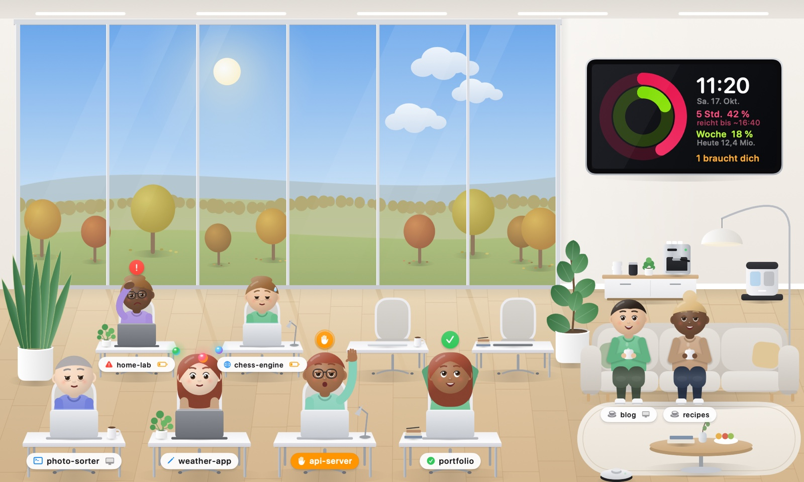

<div align="center">


<h1>AgentBar</h1>

<p><sub><b>FÜR CLAUDE CODE AUF DEM MAC</b></sub></p>

<p><b>Deine Agenten. In der Menüleiste.</b><br/>
AgentBar zeigt, was jede <a href="https://docs.anthropic.com/en/docs/claude-code">Claude-Code</a>-Sitzung gerade tut, ruhig, bis eine dich braucht.<br/>
Dazu ein kleines Büro, in dem deine Agenten wirklich arbeiten.</p>

<p><a href="README.md">🇬🇧 English</a> &nbsp;·&nbsp; 🇩🇪 Deutsch</p>

[](https://github.com/SH1FT-W/agentbar/releases/latest)
[](#setup)
[](#setup)
[](LICENSE)

<p><a href="https://sh1ft-w.github.io/agentbar"><b>Website</b></a> &nbsp;·&nbsp; <a href="https://github.com/SH1FT-W/agentbar/releases/latest"><b>Laden</b></a> &nbsp;·&nbsp; <a href="#new">Neu</a> &nbsp;·&nbsp; <a href="#menu">Menü</a> &nbsp;·&nbsp; <a href="#office">Büro</a> &nbsp;·&nbsp; <a href="#macs">Andere Macs</a> &nbsp;·&nbsp; <a href="#setup">Einrichten</a> &nbsp;·&nbsp; <a href="#privacy">Datenschutz</a> &nbsp;·&nbsp; <a href="https://github.com/SH1FT-W/agentbar/releases">Releases</a></p>

<br/>



</div>

<br/>

<a id="new"></a>
<sub><b>GERADE NEU</b></sub>
## Ein lebendigeres Büro.

Die letzten Releases haben dem Team eine Kaffeebar gebracht, vier Jahreszeiten vor dem Fenster, ein paar Feiertage zum Verkleiden und Momente, die man nur ab und zu erwischt.

| | |
|:--|:--|
| **Kaffeebar** <sub>2.3</sub> | Agenten, die gerade eine Aufgabe erledigt haben, gehen manchmal zur Siebträgermaschine hinter dem Sofa, stellen sich an, plaudern kurz und nehmen die Tasse mit an den Schreibtisch. |
| **Jahreszeiten** <sub>2.3</sub> | Die Bäume blühen im Frühling, färben sich im Herbst golden und werden im Winter kahl. Auf der Südhalbkugel versetzt, sobald ein Wetter-Ort gesetzt ist. |
| **Halloween** <sub>2.3</sub> | Kürbisse auf den Tischen, Papier-Fledermäuse an der Scheibe, Kostüme fürs Team und ein Geisterlaken über dem Saugroboter. |
| **Ostern und Valentinstag** <sub>2.3</sub> | Ein Eierbaum, versteckte Eier und Hasenohren zu Ostern. Herzen im Februar. Advent, Weihnachten und Silvester gab es schon. |
| **Seltene Momente** <sub>2.3</sub> | Manches passiert nur hin und wieder: eine Sternschnuppe, ein Vogelschwarm, ein Regenbogen bei Nieselregen, ein Schneemann, wenn Schnee liegt, Pizza am Freitagmittag. Behalt das Fenster im Blick. |
| **Kalender-Versionen** <sub>26.10.11</sub> | Versionen zählen jetzt Jahr.Monat.Nummer: 26.10.11 ist das 11. Release im Oktober 2026. Die Update-Prüfung sieht es als neuer als 2.3.1 an, für dich ändert sich nichts. |

Jede Änderung, Release für Release, in den [Releases](https://github.com/SH1FT-W/agentbar/releases).

<br/>

<a id="menu"></a>
<sub><b>DAS MENÜ</b></sub>
## Sieht aus, als wäre es schon dabei gewesen.

Aufgebaut wie die Systemmenüs in macOS 27. Jede Sitzung mit Status, Projekt und dem, was sie gerade tut, dein Kontingent als Aktivitätsringe und ein kleiner Kontext-Balken, der orange wird, bevor einer Sitzung der Platz ausgeht.

<div align="center">
<picture>
  <source media="(prefers-color-scheme: dark)" srcset="docs/screenshots/de/menu-live-dark.png" />
  
</picture>
</div>

AgentBar sieht Sitzungen aus dem Terminal, der Claude-App, Cowork und Xcode. Subagenten erscheinen als Helfer ihrer Sitzung.

- **Weiß, wann du gebraucht wirst.** Arbeitet, wartet auf Freigabe, fertig, Fehler oder Pause. Mit Claude-Code-Hooks weiß AgentBar es sofort, statt es aus Pausen zu raten.
- **Kontingent als Ringe.** Dein 5-Stunden- und Wochenkontingent im Apple-Watch-Stil, mit Prognose, wie lange das Fenster bei deinem Tempo reicht. Das Token wird nur gelesen, nie erneuert.
- **Heute und 7 Tage.** Tokens, API-Gegenwert und Sitzungen pro Tag, ein 7-Tage-Diagramm und deine Top-Projekte von heute. Lokal aus den Protokollen von Claude Code berechnet.
- **Kontext auf einen Blick.** Jede Zeile zeigt Tokens und einen kleinen Kontext-Balken. Er wird orange, wenn das Fenster fast voll ist, und die Figur im Büro sieht dann auch müde aus.
- **Direkt hinspringen.** Klick auf eine Figur im Büro oder drück Return im Menü, und genau der Terminal-Tab der Sitzung kommt nach vorn.
- **Mitteilungen.** Wenn ein Agent dich braucht (mit seiner Frage), fertig ist, scheitert, der Kontext voll wird oder er hängt. Mit Ruhezeiten, „1 Std. stumm“ und einem Hinweis auf neue AgentBar-Versionen.
- **Tastatur und VoiceOver.** Pfeiltasten wählen, Return springt, Leertaste klappt auf, ⌘R lädt neu. Jede Zeile und jeder Ring hat eine Bedienhilfen-Beschriftung.
- **Wach bleiben.** Verhindert den Ruhezustand: immer oder nur, solange Agenten arbeiten. Dazu Start beim Anmelden und das Update-Fenster mit „Jetzt installieren“, „Später“ oder „Überspringen“.

<details>
<summary><b>So funktioniert die Erkennung</b></summary>
<br/>

Ohne Hooks liest AgentBar die JSONL-Protokolle von Claude Code und leitet den Zustand ab (zum Beispiel: ein Werkzeugaufruf, auf den in einem Modus mit Rückfragen länger kein Ergebnis folgt, wartet vermutlich auf Freigabe). Mit Hooks meldet Claude Code `PreToolUse`, `PermissionRequest`, `Notification`, `Stop` und so weiter direkt, und AgentBar prüft zusätzlich, ob der Claude-Prozess noch läuft.

</details>

<br/>

<a id="office"></a>
<sub><b>DAS BÜRO</b></sub>
## Drück ⌃⌥A. Jede Sitzung bekommt einen Schreibtisch.

Ein schwebendes Fenster, in dem jede Sitzung eine Memoji-artige Figur ist. Sie tippen beim Arbeiten, heben die Hand, wenn sie dich brauchen, gehen in der Pause in die Lounge und wirken umso müder, je voller ihr Kontext ist. Nach `/compact` wieder frisch.

| Spät abends, warmes Licht | Die Lounge |
|:---:|:---:|
|  |  |
| Der Saugroboter fährt in seine Ladestation, wenn die Lampen angehen. | In der Lounge sammelt sich, wer gerade nichts zu tun hat. |

- **Himmel, Wetter, Tageslicht.** Der Himmel folgt deiner Uhrzeit. Trag einen Ort ein, und du bekommst Wolken, Regen, der an der Scheibe herunterläuft, Nebel, Gewitter und Schnee, der auf den Hügeln liegen bleibt, den echten Sonnenauf- und -untergang und Lampen, die bei trübem Wetter angehen. Wetter von Open-Meteo, gesendet wird nur der Ort, auf etwa 1 km gerundet.
- **Feiertage und Outfits.** Das Büro schmückt sich zum Valentinstag, zu Ostern, Halloween, im Advent, zu Nikolaus, Weihnachten und Silvester, und das Team zieht sich passend zu Anlass und Wetter an: Weihnachtsmützen, Geweihe, Partyhüte, Schals bei Frost, Sonnenbrillen bei Hitze.
- **Helfer kreisen.** Subagenten erscheinen als leuchtende Kugeln um ihre Figur. Der Saugroboter wird mit der CPU-Last schneller und fährt abends in seine Ladestation.
- **Ein Look pro Sitzung.** Jede Figur wählt täglich ihren Look und behält ihn für die ganze Sitzung. Ein Klick holt ihren Terminal-Tab nach vorn.

| Echtes Wetter von deinem Ort | Schnee bleibt liegen, bei Frost gibt es Schals |
|:---:|:---:|
|  |  |
| **Im Advent schmückt es sich von selbst** | **Partyhüte und Feuerwerk an Silvester** |
|  |  |

<details>
<summary><b>Mehr Bilder</b></summary>
<br/>

| Kaffeebar | Halloween |
|:---:|:---:|
|  |  |
| **Frühling** | **Ostern** |
|  |  |

</details>

<br/>

<a id="macs"></a>
<sub><b>ANDERE MACS</b></sub>
## Ein Büro für alle deine Macs.

Koppel deine Macs per Code, und die Sitzungen der anderen erscheinen im Menü und im Büro, markiert mit einem kleinen Geräte-Symbol. Gefunden wird per Bonjour im lokalen Netzwerk, jede Nachricht ist mit dem Code verschlüsselt.

1. **Andere Macs einschalten** in den Einstellungen und auf jedem Mac denselben Kopplungscode eintragen.
2. **Kurz warten.** Ein Mac antwortet erst, wenn die Gegenseite bewiesen hat, dass sie den Code kennt.
3. **Fertig.** Geteilt werden nur Status, Projekt, Titel und Tätigkeit der Sitzungen, nie Dateien oder Protokolle.

<details>
<summary><b>Die Einstellungen</b></summary>
<br/>

<div align="center">
<picture>
  <source media="(prefers-color-scheme: dark)" srcset="docs/screenshots/de/settings-dark.png" />
  
</picture>
</div>

</details>

<br/>

<a id="setup"></a>
<sub><b>EINRICHTEN</b></sub>
## In einer Minute eingerichtet.

Kein Konto, kein Installer. Nur die App. Alles jenseits der zwei Voraussetzungen ist optional und aus, bis du es einschaltest.

| | |
|:--|:--|
| **macOS 14 oder neuer** auf Apple Silicon (gebaut und getestet auf macOS 27) | Nötig |
| **[Claude Code](https://docs.anthropic.com/en/docs/claude-code)**, AgentBar liest dessen lokale Sitzungsprotokolle | Nötig |
| **Claude-Code-Hooks** für die präzise Erkennung | Optional |
| **Ein Wetter-Ort** für echtes Wetter im Büro | Optional |
| **Andere Macs** per Code gekoppelt | Optional |

### Installieren

1. `AgentBar.zip` aus dem [neuesten Release](https://github.com/SH1FT-W/agentbar/releases/latest) laden und entpacken.
2. `AgentBar.app` in den Ordner **Programme** ziehen.
3. **Ersten Start erlauben.** AgentBar ist Open Source, aber nicht von Apple notarisiert (dafür braucht es einen kostenpflichtigen Entwickler-Account). macOS blockiert deshalb den ersten Start mit *„AgentBar“ kann nicht geöffnet werden*. Einmal erlauben, auf eine der beiden Arten:
   - **Systemeinstellungen → Datenschutz & Sicherheit** öffnen, nach unten zu *„AgentBar“ wurde blockiert* scrollen, **Trotzdem öffnen** klicken und bestätigen; **oder**
   - im Terminal:
     ```sh
     xattr -dr com.apple.quarantine /Applications/AgentBar.app
     ```
   Nur der erste Start braucht diesen Schritt. Spätere Updates kommen über das eingebaute Update-Fenster und werden per Ed25519-Signatur (Schlüssel fest in der App), Bundle-ID, Version und Code-Signatur geprüft.
4. Starten. Oben in der Menüleiste erscheint ein kleines Clawd-Symbol (Augen zu: Pause, Augen auf: arbeitet, winkt: eine Sitzung braucht dich). Ein Dock-Symbol gibt es nicht.

### Erster Start

- **Mitteilungen:** macOS fragt einmal, ob AgentBar Mitteilungen senden darf.
- **Präzise Erkennung:** im Menü bei *Präzise Erkennung* auf **Einrichten** klicken (oder *Einstellungen → Präzise Erkennung*). AgentBar trägt kleine Hook-Befehle in `~/.claude/settings.json` ein (eine Sicherung landet in `settings.json.agentbar-backup`). Jeder Hook hängt nur eine Statuszeile an `~/Library/Application Support/AgentBar/hooks.log` an: kein Netzwerk, keine Prompts oder Dateiinhalte, kein AgentBar-Prozess beteiligt. Gilt für danach gestartete Claude-Sitzungen und lässt sich in den Einstellungen jederzeit wieder entfernen.
- **Kontingent-Ringe:** AgentBar liest den Login von Claude Code aus dem Schlüsselbund (`Claude Code-credentials`) über das `security`-Werkzeug. Falls macOS fragt: erlauben. Das Token geht nur an `api.anthropic.com`.
- **Wetter:** unter *Einstellungen → Büro* einen Ort eintragen, wenn du das echte Wetter hinter der Glasfront willst. Ohne Ort folgt das Büro nur der Tageszeit.
- **Zum Terminal springen:** beim ersten Sprung zu einer Sitzung fragt macOS, ob AgentBar das Terminal steuern darf. Das dient nur dazu, den richtigen Tab auszuwählen.
- **Beim Anmelden starten:** in *Einstellungen → Allgemein* einschalten.
- **Sprache:** AgentBar folgt der Sprache deines Macs, Deutsch oder Englisch.

### Tastenkürzel

| Kürzel | Aktion |
|:--|:--|
| ⌃⌥A | Büro zeigen oder ausblenden (systemweit) |
| ⌘, | Einstellungen (bei geöffnetem Menü) |
| ⌘R | Sitzungsliste neu laden |

### Selbst bauen

Xcode ist nicht nötig, die Command Line Tools reichen (`xcode-select --install`).

```sh
git clone https://github.com/SH1FT-W/agentbar.git
cd agentbar
./build.sh            # build/AgentBar.app
./build.sh install    # nach /Applications kopieren und starten
./build.sh snapshot   # Büro + Menü als PNG nach build/
```

`build.sh` nimmt bevorzugt ein macOS-26-SDK aus den Command Line Tools (dem SDK 27 dort fehlt das SwiftUI-Macro-Plugin); überschreibbar mit `SDK=/pfad/zum/sdk ./build.sh`.

Diagnose: `build/AgentBar.app/Contents/MacOS/AgentBar --dump` listet die erkannten Sitzungen und beendet sich. Sprache testen: `AGENTBAR_LANG=en` bzw. `=de`.

### Versionen

AgentBar nutzt Kalender-Versionen **`JJ.M.N`**: zweistelliges Jahr, Monat ohne führende Null und die laufende Nummer des Releases in diesem Monat. `26.10.11` ist das elfte Release im Oktober 2026; der nächste Monat beginnt wieder bei `.1` (zum Beispiel `26.11.1`). Jedes Release, Funktion oder Fix, bekommt die nächste Nummer. Tags und Release-Titel tragen ein `v` davor (`v26.10.11`). Der Sprung vom alten Schema `2.3.1` auf `26.10.11` ist gewollt: die Update-Prüfung sieht die neue Nummer als neuer an, „Nach Updates suchen“ findet sie also wie gewohnt.

<br/>

<a id="privacy"></a>
<sub><b>DATENSCHUTZ</b></sub>
## Es bleibt auf deinem Mac.

- **Nur lokale Dateien.** AgentBar liest die Sitzungsprotokolle von Claude Code (`~/.claude/projects`), die Metadaten der Claude-App und das eigene Hook-Log. Keine Analyse, keine Telemetrie.
- **Das Token wird nur gelesen.** Für die Kontingent-Ringe liest AgentBar den Login von Claude Code aus dem Schlüsselbund und schickt ihn nur an Anthropic. Er wird nie erneuert, verändert oder woanders gespeichert.
- **Open Source.** Die ganze App liegt unter MIT-Lizenz auf [GitHub](https://github.com/SH1FT-W/agentbar), und du kannst sie mit den Command Line Tools selbst bauen.

Die einzigen Server, mit denen es spricht:

| | |
|:--|:--|
| `api.anthropic.com` | dein Kontingent, nur solange *Kontingent abrufen* an ist |
| `api.github.com` | Update-Prüfung |
| `api.open-meteo.com`, `geocoding-api.open-meteo.com` | Wetter hinter der Glasfront, erst wenn du einen Ort einträgst; der Ort wird auf etwa 1 km gerundet |
| Deine anderen Macs | nur wenn du sie koppelst, im lokalen Netzwerk, mit dem Kopplungscode verschlüsselt; geteilt werden nur Status, Projekt, Titel und Tätigkeit der Sitzungen, nie Dateien oder Protokolle |

<br/>

<sub><b>DANK</b></sub>
## Inspiriert von so-agentbar

AgentBar wurde von [so-agentbar](https://github.com/sotthang/so-agentbar) von sotthang inspiriert. Es ist eine eigenständige Neuentwicklung mit anderem Design und Funktionsumfang.

AgentBar ist ein unabhängiges Open-Source-Projekt, nicht verbunden mit Anthropic oder Apple. Claude ist eine Marke von Anthropic. Lizenz: [MIT](LICENSE).

<br/>

<div align="center">
  <sub>Ein <a href="https://sh1ft-w.github.io"><b>SH1FT-W</b></a>-Projekt &nbsp;·&nbsp; <a href="https://sh1ft-w.github.io/casora">Casora</a> &nbsp;·&nbsp; <a href="https://sh1ft-w.github.io/flode">FLODE</a> &nbsp;·&nbsp; <a href="https://sh1ft-w.github.io/pulse">Pulse</a> &nbsp;·&nbsp; <a href="https://sh1ft-w.github.io/evenlight">Evenlight</a> &nbsp;·&nbsp; <a href="https://sh1ft-w.github.io/sharemount">ShareMount</a> &nbsp;·&nbsp; Gebaut mit <a href="https://claude.ai">Claude</a></sub>
</div>
