<div align="center">

<picture>
  <source media="(prefers-color-scheme: dark)" srcset="docs/images/readme-title-de-dark.webp" />
  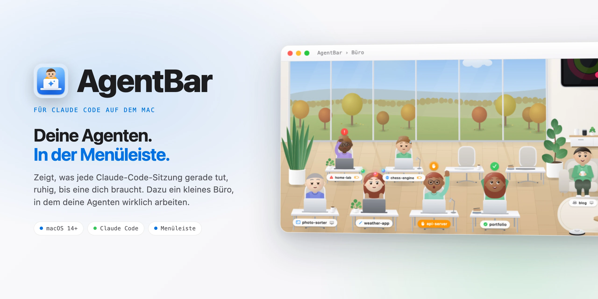
</picture>

<p>AgentBar zeigt, was jede <a href="https://docs.anthropic.com/en/docs/claude-code">Claude-Code</a>-Sitzung gerade tut, ruhig, bis eine dich braucht.<br/>
Dazu ein kleines Büro, in dem deine Agenten wirklich arbeiten.</p>

<p><a href="README.md">🇬🇧 English</a> &nbsp;·&nbsp; 🇩🇪 Deutsch</p>

[](https://github.com/SH1FT-W/agentbar/releases/latest)
[](#setup)
[](#setup)
[](LICENSE)

<p><a href="https://sh1ft-w.github.io/agentbar"><b>Website</b></a> &nbsp;·&nbsp; <a href="https://github.com/SH1FT-W/agentbar/releases/latest"><b>Laden</b></a> &nbsp;·&nbsp; <a href="#new">Neu</a> &nbsp;·&nbsp; <a href="#menu">Menü</a> &nbsp;·&nbsp; <a href="#office">Büro</a> &nbsp;·&nbsp; <a href="#macs">Andere Macs</a> &nbsp;·&nbsp; <a href="#setup">Einrichten</a> &nbsp;·&nbsp; <a href="#privacy">Datenschutz</a> &nbsp;·&nbsp; <a href="https://github.com/SH1FT-W/agentbar/releases">Releases</a></p>

</div>

<br/>

<a id="new"></a>
<sub><b>GERADE NEU</b></sub>
## Ein lebendigeres Büro.

Die letzten Releases haben dem Team eine Kaffeebar gebracht, vier Jahreszeiten vor dem Fenster, ein paar Feiertage zum Verkleiden und Momente, die man nur ab und zu erwischt.

<!-- cards:new-de -->
<table>
<tr><td width="34" valign="top"><picture><source media="(prefers-color-scheme: dark)" srcset="docs/images/icons/coffee-outline-dark.svg"></picture></td><td width="46%" valign="top"><b>Kaffeebar</b> <code>2.3</code><br>Agenten, die gerade eine Aufgabe beendet haben, gehen manchmal zur Espressomaschine, stellen sich an, plaudern kurz und bringen die Tasse zurück an den Platz.</td><td width="34" valign="top"><picture><source media="(prefers-color-scheme: dark)" srcset="docs/images/icons/leaf-dark.svg"></picture></td><td width="46%" valign="top"><b>Jahreszeiten</b> <code>2.3</code><br>Die Bäume blühen im Frühling, werden im Herbst golden und sind im Winter kahl. Für die Südhalbkugel gespiegelt, sobald ein Wetterort gesetzt ist.</td></tr>
<tr><td width="34" valign="top"><picture><source media="(prefers-color-scheme: dark)" srcset="docs/images/icons/halloween-dark.svg"></picture></td><td width="46%" valign="top"><b>Halloween</b> <code>2.3</code><br>Kürbisse auf den Tischen, Papierfledermäuse am Glas, Kostüme fürs Team und ein Geisterlaken über dem Saugroboter.</td><td width="34" valign="top"><picture><source media="(prefers-color-scheme: dark)" srcset="docs/images/icons/cellphone-wireless-dark.svg"></picture></td><td width="46%" valign="top"><b>Remote Control</b> <code>26.10.12</code><br>Sitzungen, die du per Remote Control vom Handy oder von claude.ai steuerst, tragen ein kleines Handy-Symbol neben dem Namen, auch auf deinen anderen Macs.</td></tr>
<tr><td width="34" valign="top"><picture><source media="(prefers-color-scheme: dark)" srcset="docs/images/icons/star-shooting-outline-dark.svg"></picture></td><td width="46%" valign="top"><b>Seltene Momente</b> <code>2.3</code><br>Eine Sternschnuppe, ein Vogelschwarm, ein Regenbogen bei leichtem Regen, ein Schneemann, wenn Schnee liegen bleibt, Pizza am Freitagmittag.</td><td width="34" valign="top"><picture><source media="(prefers-color-scheme: dark)" srcset="docs/images/icons/calendar-outline-dark.svg"></picture></td><td width="46%" valign="top"><b>Kalender-Versionen</b> <code>26.10.11</code><br>Versionen zählen Jahr.Monat.Nummer: 26.10.11 ist das 11. Release im Oktober 2026. Die Update-Prüfung sieht es als neuer als 2.3.1.</td></tr>
</table>
<!-- /cards:new-de -->

Jede Änderung, Release für Release, in den [Releases](https://github.com/SH1FT-W/agentbar/releases).

<br/>

<a id="menu"></a>
<sub><b>DAS MENÜ</b></sub>
## Sieht aus, als wäre es schon dabei gewesen.

Aufgebaut wie die Systemmenüs in macOS 27. Jede Sitzung mit Status, Projekt und dem, was sie gerade tut, dein Kontingent als Aktivitätsringe und ein kleiner Kontext-Balken, der orange wird, bevor einer Sitzung der Platz ausgeht.

<div align="center">
<picture>
  <source media="(prefers-color-scheme: dark)" srcset="docs/screenshots/de/menu-live-dark.png" />
  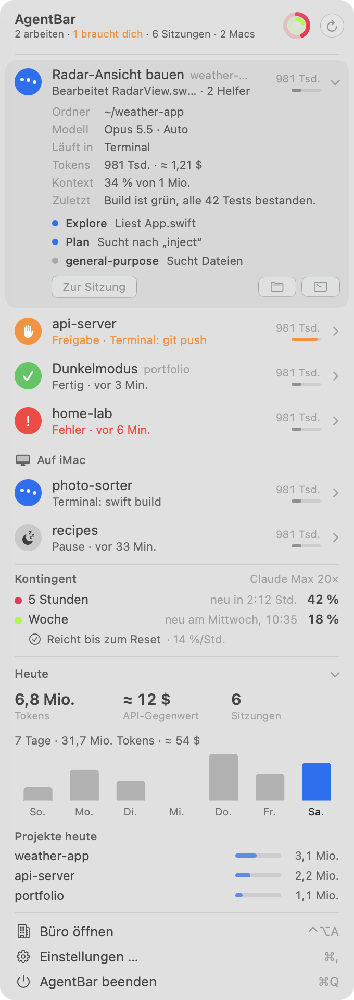
</picture>
</div>

AgentBar sieht Sitzungen aus dem Terminal, der Claude-App, Cowork und Xcode. Subagenten erscheinen als Helfer ihrer Sitzung.

<!-- cards:menu-de -->
<table>
<tr><td width="34" valign="top"><picture><source media="(prefers-color-scheme: dark)" srcset="docs/images/icons/hand-wave-outline-dark.svg"></picture></td><td width="46%" valign="top"><b>Weiß, wann du gebraucht wirst</b><br>Arbeitet, wartet auf Freigabe, fertig, Fehler oder untätig. Mit Claude-Code-Hooks weiß AgentBar es in dem Moment, statt aus Pausen zu raten.</td><td width="34" valign="top"><picture><source media="(prefers-color-scheme: dark)" srcset="docs/images/icons/chart-donut-dark.svg"></picture></td><td width="46%" valign="top"><b>Kontingent als Aktivitätsringe</b><br>Dein 5-Stunden- und Wochenkontingent im Apple-Watch-Stil, mit Prognose, wie lange das Fenster bei deinem Tempo reicht. Der Token wird nur gelesen.</td></tr>
<tr><td width="34" valign="top"><picture><source media="(prefers-color-scheme: dark)" srcset="docs/images/icons/chart-bar-dark.svg"></picture></td><td width="46%" valign="top"><b>Heute und 7 Tage</b><br>Tokens, API-Gegenwert und Sitzungen pro Tag, ein 7-Tage-Diagramm und deine Top-Projekte heute. Lokal aus den Claude-Code-Logs berechnet.</td><td width="34" valign="top"><picture><source media="(prefers-color-scheme: dark)" srcset="docs/images/icons/gauge-dark.svg"></picture></td><td width="46%" valign="top"><b>Kontext auf einen Blick</b><br>Jede Zeile zeigt Tokens und einen kleinen Kontextbalken. Er wird orange, wenn das Fenster fast voll ist, und die Figur im Büro sieht müde aus.</td></tr>
<tr><td width="34" valign="top"><picture><source media="(prefers-color-scheme: dark)" srcset="docs/images/icons/console-dark.svg"></picture></td><td width="46%" valign="top"><b>Direkt hinspringen</b><br>Klick auf eine Figur im Büro oder Return im Menü, und genau der Terminal-Tab der Sitzung kommt nach vorn.</td><td width="34" valign="top"><picture><source media="(prefers-color-scheme: dark)" srcset="docs/images/icons/bell-outline-dark.svg"></picture></td><td width="46%" valign="top"><b>Mitteilungen</b><br>Wenn ein Agent dich braucht (mit seiner Frage), fertig ist, scheitert, der Kontext ausgeht oder er festzuhängen scheint. Mit Ruhezeiten und einer Stunde Stumm.</td></tr>
<tr><td width="34" valign="top"><picture><source media="(prefers-color-scheme: dark)" srcset="docs/images/icons/keyboard-outline-dark.svg"></picture></td><td width="46%" valign="top"><b>Tastatur und VoiceOver</b><br>Pfeiltasten zum Auswählen, Return zum Springen, Leertaste zum Aufklappen, ⌘R zum Neuladen. Jede Zeile und jeder Ring hat eine Beschriftung.</td><td width="34" valign="top"><picture><source media="(prefers-color-scheme: dark)" srcset="docs/images/icons/coffee-dark.svg"></picture></td><td width="46%" valign="top"><b>Wach bleiben</b><br>Den Mac am Schlafen hindern: immer oder nur, solange Agenten arbeiten. Dazu Start bei der Anmeldung und das Update-Fenster.</td></tr>
</table>
<!-- /cards:menu-de -->

<details>
<summary><b>So funktioniert die Erkennung</b></summary>
<br/>

Ohne Hooks liest AgentBar die JSONL-Protokolle von Claude Code und leitet den Zustand ab (zum Beispiel: ein Werkzeugaufruf, auf den in einem Modus mit Rückfragen länger kein Ergebnis folgt, wartet vermutlich auf Freigabe). Mit Hooks meldet Claude Code `PreToolUse`, `PermissionRequest`, `Notification`, `Stop` und so weiter direkt, und AgentBar prüft zusätzlich, ob der Claude-Prozess noch läuft.

</details>

<br/>

<a id="office"></a>
<sub><b>DAS BÜRO</b></sub>
## Drück ⌃⌥A. Jede Sitzung bekommt einen Schreibtisch.

Ein schwebendes Fenster, in dem jede Sitzung eine Memoji-artige Figur ist. Sie tippen beim Arbeiten, heben die Hand, wenn sie dich brauchen, gehen in der Pause in die Lounge und wirken umso müder, je voller ihr Kontext ist. Nach `/compact` wieder frisch.

<p align="center">
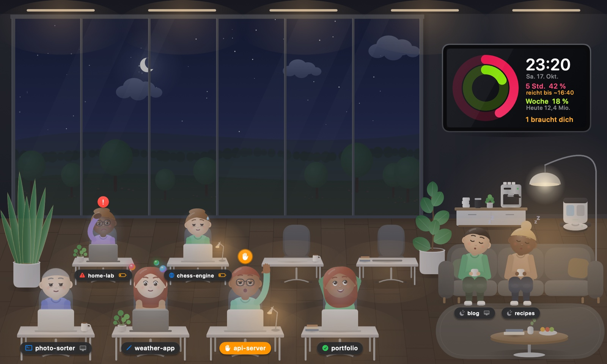
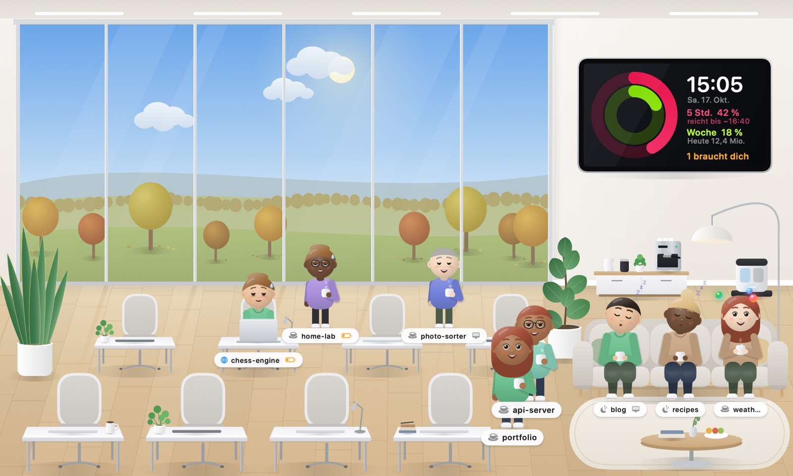
<br/><sub>Spät abends, warmes Licht: der Saugroboter fährt in seine Ladestation, wenn die Lampen angehen. In der Lounge sammelt sich, wer gerade nichts zu tun hat.</sub>
</p>

<!-- cards:office-de -->
<table>
<tr><td width="34" valign="top"><picture><source media="(prefers-color-scheme: dark)" srcset="docs/images/icons/weather-partly-cloudy-dark.svg"></picture></td><td width="46%" valign="top"><b>Himmel, Wetter, Tageslicht</b><br>Der Himmel folgt deiner Ortszeit. Mit einem Ort kommen Wolken, Regen am Glas, Nebel, Schnee auf den Hügeln, echter Sonnenauf- und -untergang. Nur der auf etwa 1 km gerundete Ort wird gesendet.</td><td width="34" valign="top"><picture><source media="(prefers-color-scheme: dark)" srcset="docs/images/icons/party-popper-dark.svg"></picture></td><td width="46%" valign="top"><b>Feiertage und Outfits</b><br>Das Büro schmückt sich zu Valentinstag, Ostern, Halloween, Advent, Weihnachten und Silvester, und das Team kleidet sich passend zum Anlass und zum Wetter.</td></tr>
<tr><td width="34" valign="top"><picture><source media="(prefers-color-scheme: dark)" srcset="docs/images/icons/orbit-dark.svg"></picture></td><td width="46%" valign="top"><b>Helfer kreisen</b><br>Subagenten erscheinen als leuchtende Kugeln um ihre Figur. Der Saugroboter wird mit deiner CPU-Last schneller und dockt abends an.</td><td width="34" valign="top"><picture><source media="(prefers-color-scheme: dark)" srcset="docs/images/icons/account-outline-dark.svg"></picture></td><td width="46%" valign="top"><b>Ein Aussehen je Sitzung</b><br>Jede Figur wählt täglich ihr Aussehen und behält es für die ganze Sitzung. Klick auf eine, und ihr Terminal-Tab kommt nach vorn.</td></tr>
</table>
<!-- /cards:office-de -->

<p align="center">
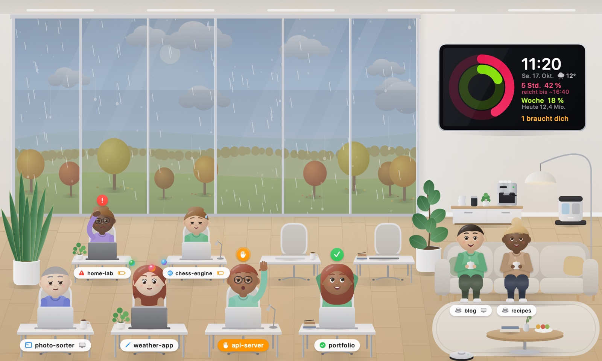
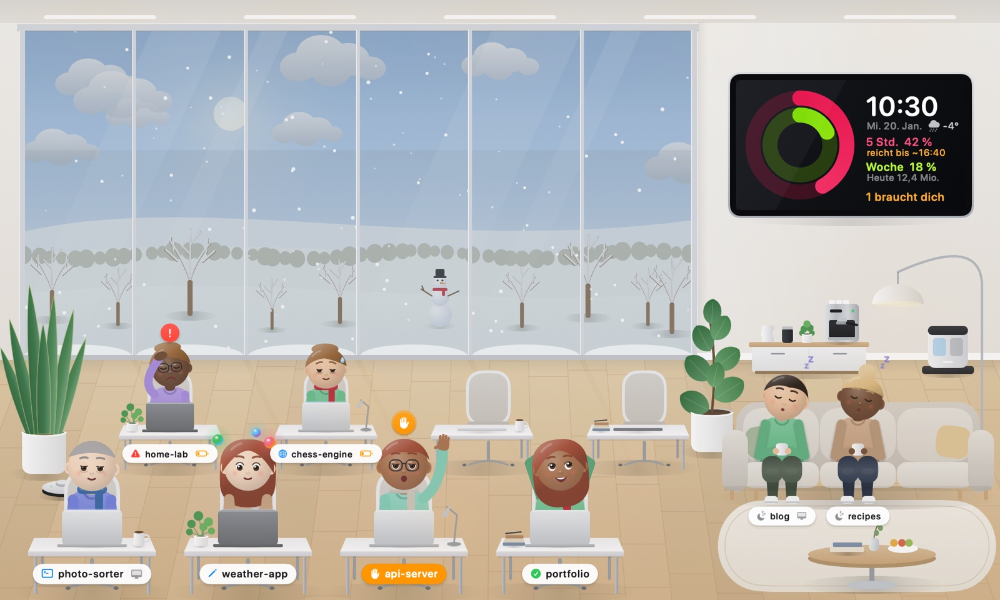
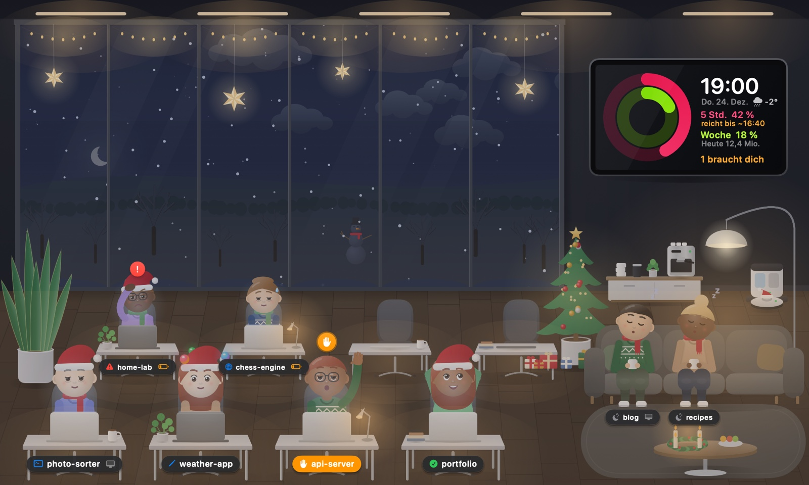
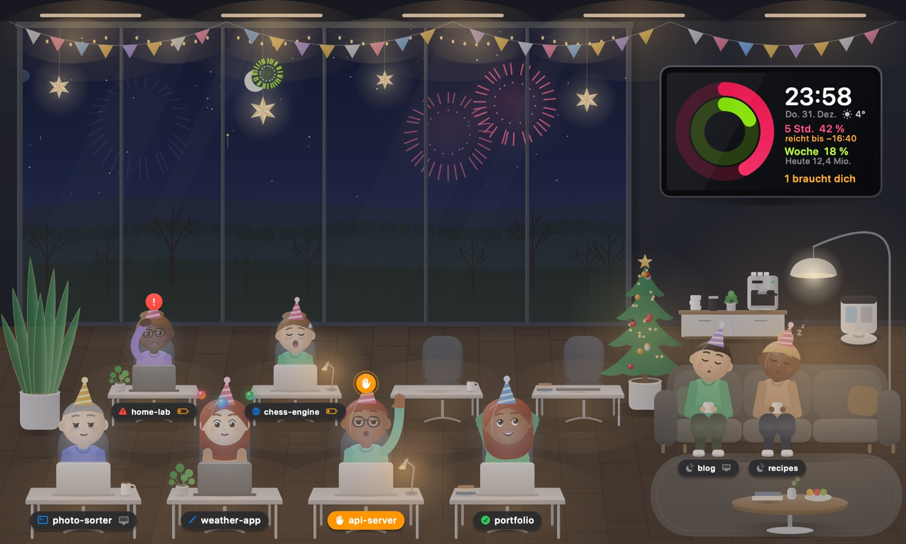
<br/><sub>Echtes Wetter von deinem Ort. Schnee bleibt liegen, bei Frost gibt es Schals. Im Advent schmückt es sich von selbst. Partyhüte und Feuerwerk an Silvester.</sub>
</p>

<details>
<summary><b>Mehr Bilder</b></summary>
<br/>

<p align="center">
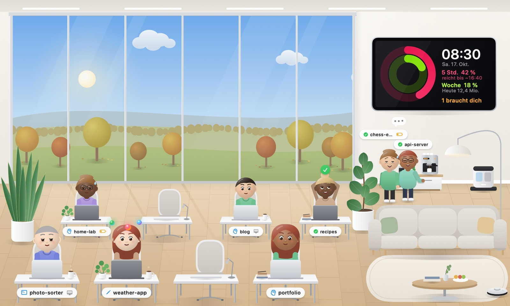
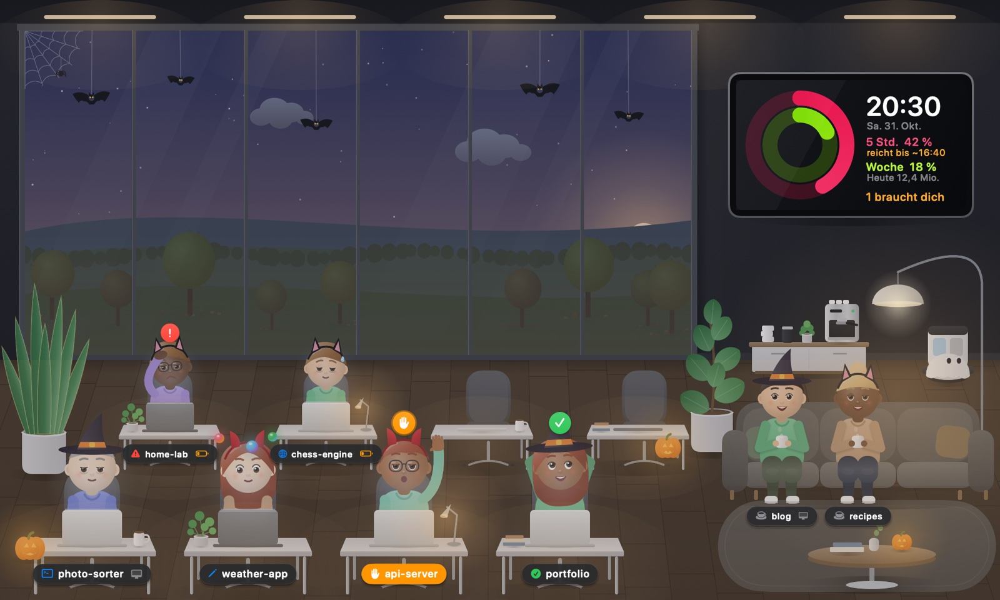
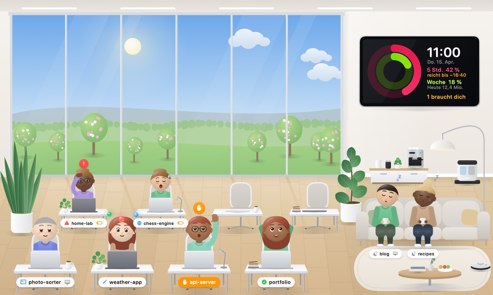
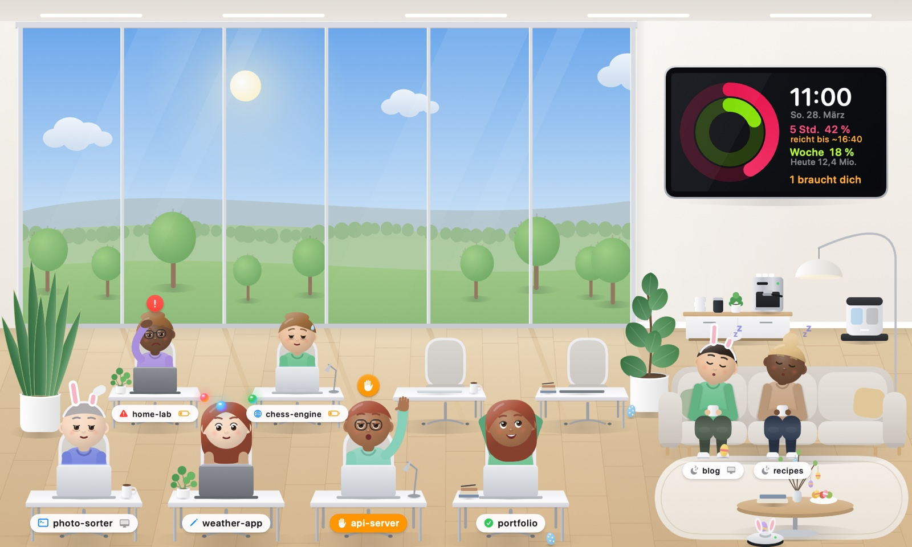
<br/><sub>Kaffeebar, Halloween, Frühling und Ostern.</sub>
</p>

</details>

<br/>

<a id="macs"></a>
<sub><b>ANDERE MACS</b></sub>
## Ein Büro für alle deine Macs.

Koppel deine Macs per Code, und die Sitzungen der anderen erscheinen im Menü und im Büro, markiert mit einem kleinen Geräte-Symbol. Gefunden wird per Bonjour im lokalen Netzwerk, jede Nachricht ist mit dem Code verschlüsselt.

1. **Andere Macs einschalten** in den Einstellungen und auf jedem Mac denselben Kopplungscode eintragen.
2. **Kurz warten.** Ein Mac antwortet erst, wenn die Gegenseite bewiesen hat, dass sie den Code kennt.
3. **Fertig.** Geteilt werden nur Status, Projekt, Titel und Tätigkeit der Sitzungen, nie Dateien oder Protokolle.

<details>
<summary><b>Die Einstellungen</b></summary>
<br/>

<div align="center">
<picture>
  <source media="(prefers-color-scheme: dark)" srcset="docs/screenshots/de/settings-dark.png" />
  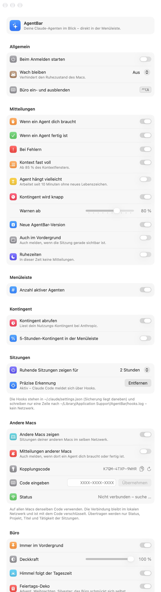
</picture>
</div>

</details>

<br/>

<a id="setup"></a>
<sub><b>EINRICHTEN</b></sub>
## In einer Minute eingerichtet.

Kein Konto, kein Installer. Nur die App. Alles jenseits der zwei Voraussetzungen ist optional und aus, bis du es einschaltest.

**Nötig:** macOS 14 oder neuer auf Apple Silicon (gebaut und getestet auf macOS 27) und [Claude Code](https://docs.anthropic.com/en/docs/claude-code), dessen lokale Sitzungsprotokolle AgentBar liest. **Optional:** Claude-Code-Hooks für die präzise Erkennung, ein Wetter-Ort für echtes Wetter im Büro und andere Macs per Code gekoppelt.

### Installieren

1. `AgentBar.zip` aus dem [neuesten Release](https://github.com/SH1FT-W/agentbar/releases/latest) laden und entpacken.
2. `AgentBar.app` in den Ordner **Programme** ziehen.
3. **Ersten Start erlauben.** AgentBar ist Open Source, aber nicht von Apple notarisiert (dafür braucht es einen kostenpflichtigen Entwickler-Account). macOS blockiert deshalb den ersten Start mit *„AgentBar“ kann nicht geöffnet werden*. Einmal erlauben, auf eine der beiden Arten:
   - **Systemeinstellungen → Datenschutz & Sicherheit** öffnen, nach unten zu *„AgentBar“ wurde blockiert* scrollen, **Trotzdem öffnen** klicken und bestätigen; **oder**
   - im Terminal:
     ```sh
     xattr -dr com.apple.quarantine /Applications/AgentBar.app
     ```
   Nur der erste Start braucht diesen Schritt. Spätere Updates kommen über das eingebaute Update-Fenster und werden per Ed25519-Signatur (Schlüssel fest in der App), Bundle-ID, Version und Code-Signatur geprüft.
4. Starten. Oben in der Menüleiste erscheint ein kleines Clawd-Symbol (Augen zu: Pause, Augen auf: arbeitet, winkt: eine Sitzung braucht dich). Ein Dock-Symbol gibt es nicht.

### Erster Start

- **Mitteilungen:** macOS fragt einmal, ob AgentBar Mitteilungen senden darf.
- **Präzise Erkennung:** im Menü bei *Präzise Erkennung* auf **Einrichten** klicken (oder *Einstellungen → Präzise Erkennung*). AgentBar trägt kleine Hook-Befehle in `~/.claude/settings.json` ein (eine Sicherung landet in `settings.json.agentbar-backup`). Jeder Hook hängt nur eine Statuszeile an `~/Library/Application Support/AgentBar/hooks.log` an: kein Netzwerk, keine Prompts oder Dateiinhalte, kein AgentBar-Prozess beteiligt. Gilt für danach gestartete Claude-Sitzungen und lässt sich in den Einstellungen jederzeit wieder entfernen.
- **Kontingent-Ringe:** AgentBar liest den Login von Claude Code aus dem Schlüsselbund (`Claude Code-credentials`) über das `security`-Werkzeug. Falls macOS fragt: erlauben. Das Token geht nur an `api.anthropic.com`.
- **Wetter:** unter *Einstellungen → Büro* einen Ort eintragen, wenn du das echte Wetter hinter der Glasfront willst. Ohne Ort folgt das Büro nur der Tageszeit.
- **Zum Terminal springen:** beim ersten Sprung zu einer Sitzung fragt macOS, ob AgentBar das Terminal steuern darf. Das dient nur dazu, den richtigen Tab auszuwählen.
- **Beim Anmelden starten:** in *Einstellungen → Allgemein* einschalten.
- **Sprache:** AgentBar folgt der Sprache deines Macs, Deutsch oder Englisch.

### Tastenkürzel

| Kürzel | Aktion |
|:--|:--|
| ⌃⌥A | Büro zeigen oder ausblenden (systemweit) |
| ⌘, | Einstellungen (bei geöffnetem Menü) |
| ⌘R | Sitzungsliste neu laden |

### Selbst bauen

Xcode ist nicht nötig, die Command Line Tools reichen (`xcode-select --install`).

```sh
git clone https://github.com/SH1FT-W/agentbar.git
cd agentbar
./build.sh            # build/AgentBar.app
./build.sh install    # nach /Applications kopieren und starten
./build.sh snapshot   # Büro + Menü als PNG nach build/
```

`build.sh` nimmt bevorzugt ein macOS-26-SDK aus den Command Line Tools (dem SDK 27 dort fehlt das SwiftUI-Macro-Plugin); überschreibbar mit `SDK=/pfad/zum/sdk ./build.sh`.

Diagnose: `build/AgentBar.app/Contents/MacOS/AgentBar --dump` listet die erkannten Sitzungen und beendet sich. Sprache testen: `AGENTBAR_LANG=en` bzw. `=de`.

### Versionen

AgentBar nutzt Kalender-Versionen **`JJ.M.N`**: zweistelliges Jahr, Monat ohne führende Null und die laufende Nummer des Releases in diesem Monat. `26.10.11` ist das elfte Release im Oktober 2026; der nächste Monat beginnt wieder bei `.1` (zum Beispiel `26.11.1`). Jedes Release, Funktion oder Fix, bekommt die nächste Nummer. Tags und Release-Titel tragen ein `v` davor (`v26.10.11`). Der Sprung vom alten Schema `2.3.1` auf `26.10.11` ist gewollt: die Update-Prüfung sieht die neue Nummer als neuer an, „Nach Updates suchen“ findet sie also wie gewohnt.

<br/>

<a id="privacy"></a>
<sub><b>DATENSCHUTZ</b></sub>
## Es bleibt auf deinem Mac.

- **Nur lokale Dateien.** AgentBar liest die Sitzungsprotokolle von Claude Code (`~/.claude/projects`), die Metadaten der Claude-App und das eigene Hook-Log. Keine Analyse, keine Telemetrie.
- **Das Token wird nur gelesen.** Für die Kontingent-Ringe liest AgentBar den Login von Claude Code aus dem Schlüsselbund und schickt ihn nur an Anthropic. Er wird nie erneuert, verändert oder woanders gespeichert.
- **Open Source.** Die ganze App liegt unter MIT-Lizenz auf [GitHub](https://github.com/SH1FT-W/agentbar), und du kannst sie mit den Command Line Tools selbst bauen.

Die einzigen Server, mit denen es spricht:

| | |
|:--|:--|
| `api.anthropic.com` | dein Kontingent, nur solange *Kontingent abrufen* an ist |
| `api.github.com` | Update-Prüfung |
| `api.open-meteo.com`, `geocoding-api.open-meteo.com` | Wetter hinter der Glasfront, erst wenn du einen Ort einträgst; der Ort wird auf etwa 1 km gerundet |
| Deine anderen Macs | nur wenn du sie koppelst, im lokalen Netzwerk, mit dem Kopplungscode verschlüsselt; geteilt werden nur Status, Projekt, Titel und Tätigkeit der Sitzungen, nie Dateien oder Protokolle |

<br/>

<sub><b>DANK</b></sub>
## Inspiriert von so-agentbar

AgentBar wurde von [so-agentbar](https://github.com/sotthang/so-agentbar) von sotthang inspiriert. Es ist eine eigenständige Neuentwicklung mit anderem Design und Funktionsumfang.

AgentBar ist ein unabhängiges Open-Source-Projekt, nicht verbunden mit Anthropic oder Apple. Claude ist eine Marke von Anthropic. Lizenz: [MIT](LICENSE).

<br/>

<div align="center">
  <sub>Ein <a href="https://sh1ft-w.github.io"><b>SH1FT-W</b></a>-Projekt &nbsp;·&nbsp; <a href="https://sh1ft-w.github.io/casora">Casora</a> &nbsp;·&nbsp; <a href="https://sh1ft-w.github.io/flode">FLODE</a> &nbsp;·&nbsp; <a href="https://sh1ft-w.github.io/pulse">Pulse</a> &nbsp;·&nbsp; <a href="https://sh1ft-w.github.io/evenlight">Evenlight</a> &nbsp;·&nbsp; <a href="https://sh1ft-w.github.io/sharemount">ShareMount</a> &nbsp;·&nbsp; Gebaut mit <a href="https://claude.ai">Claude</a></sub>
</div>
