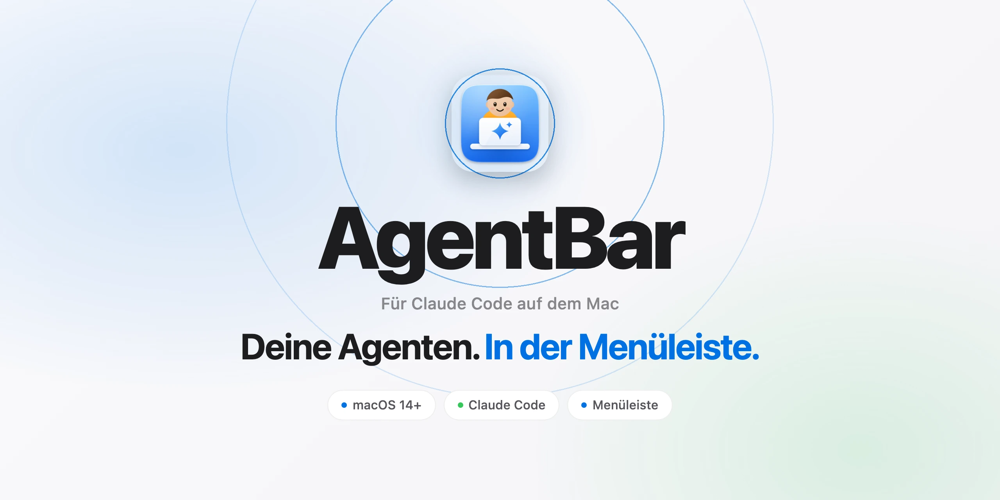
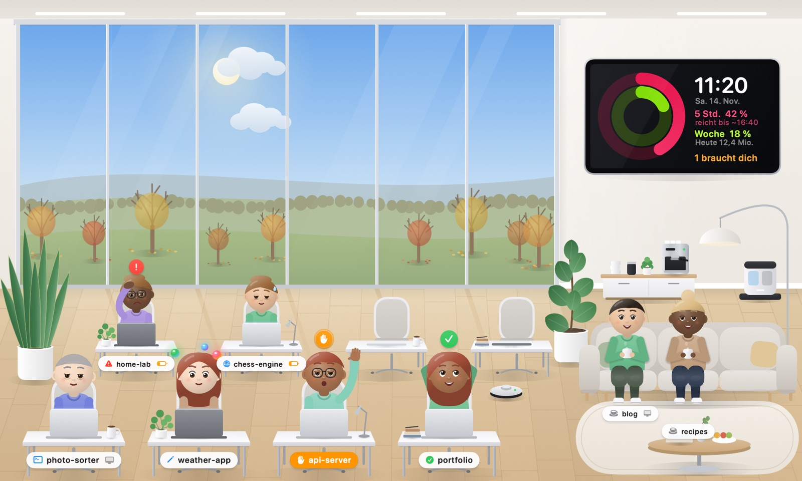
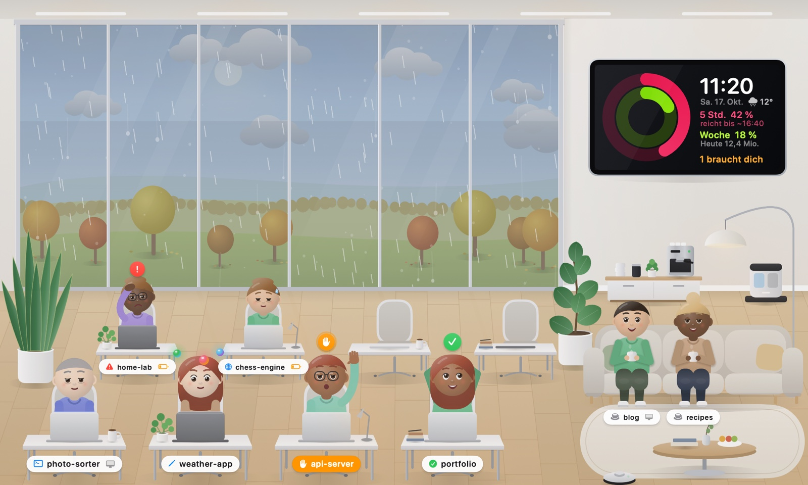
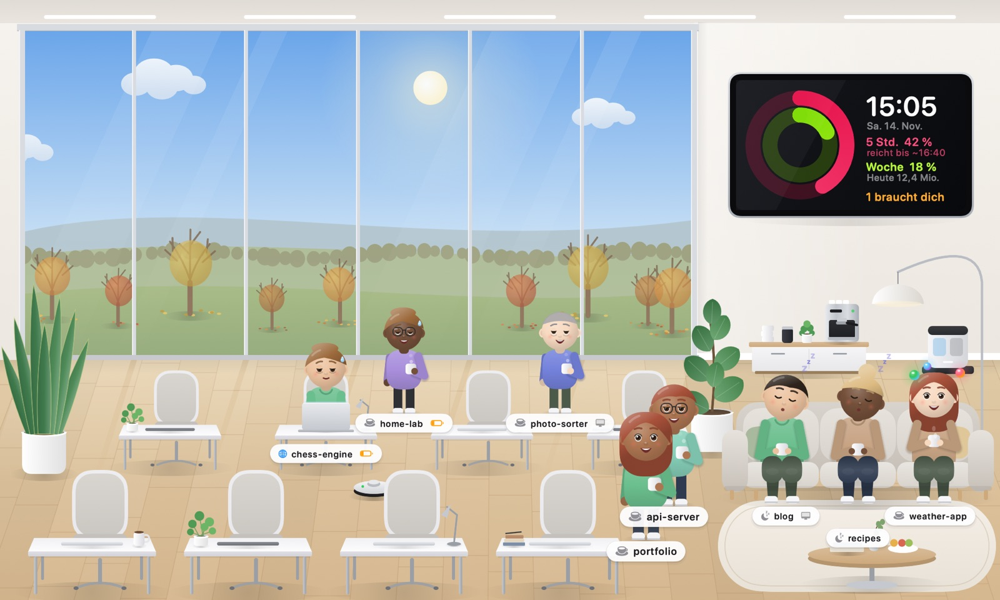
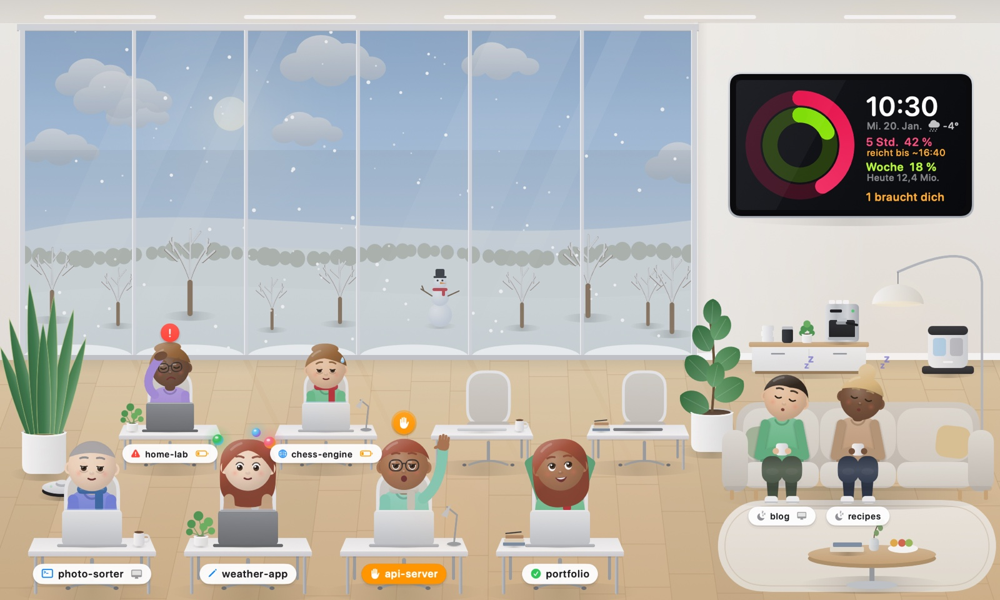
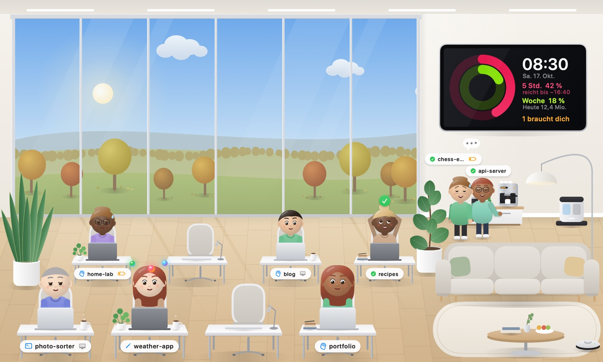

<div align="center">

<picture>
  <source media="(prefers-color-scheme: dark)" srcset="docs/images/readme-title-de-dark.webp" />
  
</picture>

[](https://github.com/SH1FT-W/agentbar/releases/latest)
[](#loslegen)
[](https://github.com/SH1FT-W/agentbar/releases/latest)

<a href="https://sh1ft-w.github.io/agentbar"><b>Website</b></a>&emsp;<a href="#loslegen">Loslegen</a>&emsp;<a href="#menue-und-buero">Menü und Büro</a>&emsp;<a href="#deine-daten">Deine Daten</a>&emsp;<a href="https://github.com/SH1FT-W/agentbar/releases">Releases</a>&emsp;<a href="README.md">English</a>

</div>

<br/>

AgentBar sitzt in der Menüleiste deines Macs und zeigt, was jede [Claude-Code](https://docs.anthropic.com/en/docs/claude-code)-Sitzung gerade tut: **arbeitet, wartet auf dich, fertig oder hängt.** Es bleibt ruhig, bis eine dich braucht. Mit ⌃⌥A öffnet sich ein kleines Büro, in dem jede Sitzung an ihrem eigenen Schreibtisch arbeitet.

AgentBar liest nur, was Claude Code auf deinem Mac schreibt. Es beantwortet keine Rückfragen und gibt nichts für dich frei; es holt den richtigen Terminal-Tab nach vorn, damit du es tun kannst.

## Was du bekommst

| | Braucht |
|:--|:--|
| Jede Sitzung mit Status, Projekt, aktueller Tätigkeit und Kontext | nichts, AgentBar liest die lokalen Protokolle von Claude Code |
| Status sofort, wenn er sich ändert (Freigabe, fertig, Fehler) | Claude-Code-Hooks, mit einem Klick eingerichtet |
| Tokens, Kosten und Sitzungen heute und über 7 Tage | nichts |
| Kontingent als Ringe (5 Stunden und Woche) | deinen Claude-Code-Login aus dem Schlüsselbund |
| Mitteilungen | dein OK, wenn macOS fragt |
| Das Büro mit Himmel und Tageszeit | nichts |
| Echtes Wetter hinter der Glasfront | einen Ort |
| Sitzungen deiner anderen Macs | denselben Kopplungscode auf jedem Mac |

**Neu in 26.11:** ruhigere und nützlichere Mitteilungen: Freigaben nach spätestens 10 Sekunden, alles andere einmal je Wartezustand nach der Verzögerung, die du wählst, ein Klick öffnet den richtigen Tab, und Kontingent-Warnungen bei 80 % und 95 %. 26.11.2 braucht deutlich weniger CPU, während Agenten arbeiten, und macht den Abgleich zwischen Macs robuster; 26.11.3 hält die Namensschilder im Büro lesbar. Jede Änderung steht in den [Releases](https://github.com/SH1FT-W/agentbar/releases).

<a id="loslegen"></a><a id="installieren"></a><a id="einrichten"></a>
## Loslegen

[](https://github.com/SH1FT-W/agentbar/releases/latest)

Du brauchst macOS 14 oder neuer auf Apple Silicon (gebaut und getestet auf macOS 27) und Claude Code. Es gibt kein Konto und kein Dock-Symbol.

1. **Installieren.** `AgentBar.zip` entpacken und `AgentBar.app` in den Ordner **Programme** ziehen. AgentBar ist nicht von Apple notarisiert (dafür braucht es einen kostenpflichtigen Entwickler-Account), deshalb blockiert macOS den ersten Start einmal: **Systemeinstellungen > Datenschutz & Sicherheit** öffnen, zu *„AgentBar“ wurde blockiert* scrollen und **Trotzdem öffnen** klicken, oder im Terminal

   ```sh
   xattr -dr com.apple.quarantine /Applications/AgentBar.app
   ```

2. **Starten.** Clawd erscheint in der Menüleiste: Augen zu, wenn alles ruht, Augen auf beim Arbeiten, winkend, wenn eine Sitzung dich braucht. Mitteilungen erlauben, wenn macOS fragt.
3. **Präzise Erkennung einschalten.** Im Menü bei *Präzise Erkennung* auf **Einrichten** klicken. AgentBar trägt kleine Hook-Befehle in `~/.claude/settings.json` ein (Sicherung in `settings.json.agentbar-backup`). Das gilt für danach gestartete Claude-Sitzungen und lässt sich in den Einstellungen wieder entfernen.
4. **Schlüsselbund erlauben.** Für die Kontingent-Ringe liest AgentBar den Login von Claude Code (`Claude Code-credentials`) über das `security`-Werkzeug. Erlauben, falls macOS fragt.
5. **Was du sonst willst.** Einen Ort unter **Einstellungen > Büro** für echtes Wetter, **Beim Anmelden starten** unter **Einstellungen > Allgemein** und **Andere Macs** mit demselben Kopplungscode auf jedem Mac.

Beim ersten Sprung zu einer Sitzung fragt macOS, ob AgentBar dein Terminal-Programm steuern darf. AgentBar folgt der Sprache deines Macs, Deutsch oder Englisch.

Spätere Updates kommen über das eingebaute Update-Fenster und werden per Ed25519-Signatur (Schlüssel fest in der App), Bundle-ID, Version und Code-Signatur geprüft.

<details>
<summary>Selbst bauen</summary>

Xcode ist nicht nötig, die Command Line Tools reichen (`xcode-select --install`).

```sh
git clone https://github.com/SH1FT-W/agentbar.git
cd agentbar
./build.sh            # build/AgentBar.app
./build.sh install    # nach /Applications kopieren und starten
```

</details>

<a id="menue-und-buero"></a>
## Menü und Büro

<div align="center">
<picture>
  <source media="(prefers-color-scheme: dark)" srcset="docs/screenshots/de/office-night.jpg" />
  
</picture>
</div>

| Teil | Zeigt |
|:--|:--|
| Sitzungszeile | Status, Projekt, was sie gerade tut, Tokens und einen Kontext-Balken, der orange wird, wenn das Fenster fast voll ist. Sitzungen aus dem Terminal, der Claude-App, Cowork und Xcode; Subagenten als Helfer. Ein Handy-Symbol markiert Remote Control, ein Geräte-Symbol einen anderen Mac. |
| Kontingent-Ringe | Dein 5-Stunden- und Wochenkontingent im Apple-Watch-Stil, mit Prognose, wie lange das Fenster bei deinem Tempo reicht. |
| Heute und 7 Tage | Tokens, API-Gegenwert und Sitzungen pro Tag, ein 7-Tage-Diagramm und deine Top-Projekte von heute. |
| Büro (⌃⌥A) | Ein schwebendes Fenster mit einer Figur pro Sitzung. Sie tippt beim Arbeiten, hebt die Hand, wenn sie dich braucht, geht in der Pause in die Lounge und wirkt müder, je voller ihr Kontext ist. |
| Mitteilungen | Wenn ein Agent dich braucht (mit seiner Frage), fertig ist, scheitert, der Kontext voll wird oder er hängt. Freigaben nach höchstens 10 Sekunden, der Rest nach einer Verzögerung deiner Wahl (Standard 20 Sekunden), einmal je Wartezustand. Kontingent-Warnungen bei 80 % und 95 %. Ruhezeiten und „1 Std. stumm“. |
| Wach bleiben | Verhindert den Ruhezustand, immer oder nur, solange Agenten arbeiten. |

Ein Klick auf eine Figur oder Return auf einer Zeile holt genau den richtigen Tab nach vorn: Terminal und iTerm2 per tty, Ghostty per Ordner. Im Menü: Pfeiltasten wählen, Leertaste klappt auf, ⌘R lädt neu, ⌘, öffnet die Einstellungen. Jede Zeile und jeder Ring hat eine VoiceOver-Beschriftung.

<details>
<summary>Was im Büro passiert</summary>
<br/>

Der Himmel folgt deiner Uhrzeit; mit einem Ort gibt es Wolken, Regen an der Scheibe, Nebel, Schnee auf den Hügeln und den echten Sonnenauf- und -untergang. Die Bäume wechseln mit den Jahreszeiten (auf der Südhalbkugel versetzt). Das Büro schmückt sich zu Valentinstag, Ostern, Halloween, Advent, Weihnachten und Silvester, und das Team kleidet sich passend zum Anlass und zum Wetter. Jede Figur wählt täglich ihren Look und behält ihn für die Sitzung. Subagenten kreisen als leuchtende Kugeln um ihre Figur, der Saugroboter wird mit der CPU-Last schneller und fährt abends in seine Station, und wer gerade fertig ist, stellt sich manchmal an der Siebträgermaschine an. Ab und zu: eine Sternschnuppe, ein Vogelschwarm, ein Regenbogen, ein Schneemann, Pizza am Freitagmittag.

<p align="center">




</p>

</details>

<a id="deine-daten"></a>
## Deine Daten

- **Nur lokale Dateien.** AgentBar liest die Sitzungsprotokolle von Claude Code (`~/.claude/projects`), die Metadaten der Claude-App und das eigene Hook-Log. Keine Analyse, keine Telemetrie.
- **Das Token wird nur gelesen.** Es geht nur an `api.anthropic.com` und wird nie erneuert, verändert oder woanders gespeichert.
- **Andere Macs** bekommen nur Status, Projekt, Titel und Tätigkeit deiner Sitzungen, nie Dateien oder Protokolle, verschlüsselt mit dem Kopplungscode.

## Gut zu wissen

- Ohne Hooks leitet AgentBar den Zustand aus Pausen in den Protokollen ab, eine wartende Freigabe kann dann später auftauchen.
- Ghostty kennt in seiner Skript-Schnittstelle kein tty. AgentBar wechselt dort den Tab nur, wenn genau ein Ghostty-Tab im Ordner der Sitzung liegt, sonst holt es Ghostty nach vorn.
- Keine Mitteilung, solange das Terminal der Sitzung vorn ist, außer *Auch im Vordergrund* ist an.
- Nur Apple Silicon.

<details>
<summary>So funktioniert es</summary>

Ohne Hooks liest AgentBar die JSONL-Protokolle von Claude Code (zum Beispiel: ein Werkzeugaufruf, auf den in einem Modus mit Rückfragen länger kein Ergebnis folgt, wartet vermutlich auf Freigabe). Mit Hooks meldet Claude Code `PreToolUse`, `PermissionRequest`, `Notification`, `Stop` und so weiter direkt: jeder Hook hängt eine Statuszeile an `~/Library/Application Support/AgentBar/hooks.log` an, ohne Netzwerk, ohne Prompts oder Dateiinhalte und ohne AgentBar-Prozess. AgentBar prüft zusätzlich, ob der Claude-Prozess noch läuft.

| Spricht mit | Wofür | Wann |
|:--|:--|:--|
| `api.anthropic.com` | dein Kontingent | nur solange *Kontingent abrufen* an ist |
| `api.github.com` | Update-Prüfung | |
| `api.open-meteo.com`, `geocoding-api.open-meteo.com` | Wetter hinter der Glasfront | erst wenn du einen Ort einträgst, auf etwa 1 km gerundet |
| deinen anderen Macs | Sitzungen der anderen Macs | nur wenn gekoppelt; gefunden per Bonjour im lokalen Netzwerk |

</details>

<details>
<summary>Entwicklung</summary>

```sh
./build.sh snapshot   # Büro und Menü als PNG nach build/
./build.sh test       # Selbsttests
build/AgentBar.app/Contents/MacOS/AgentBar --dump   # listet die erkannten Sitzungen und beendet sich
AGENTBAR_LANG=en      # oder =de, um eine Sprache zu testen
```

`build.sh` nimmt bevorzugt ein macOS-26-SDK aus den Command Line Tools (dem SDK 27 dort fehlt das SwiftUI-Macro-Plugin); überschreibbar mit `SDK=/pfad/zum/sdk ./build.sh`. Versionen sind `JJ.M.N`: `26.10.11` ist das elfte Release im Oktober 2026, die Update-Prüfung sieht es als neuer als das alte `2.3.1` an. Wie ein Release entsteht, steht in [RELEASING.md](RELEASING.md).

</details>

## Lizenz

[MIT](LICENSE). AgentBar wurde von [so-agentbar](https://github.com/sotthang/so-agentbar) von sotthang inspiriert und ist eine eigenständige Neuentwicklung mit anderem Design und Funktionsumfang.

<sub>AgentBar ist ein unabhängiges Open-Source-Projekt, nicht verbunden mit Anthropic oder Apple. Claude ist eine Marke von Anthropic.</sub>

<br/>

<div align="center">
<a href="https://sh1ft-w.github.io"></a>
<br/>
<sub>Mehr Open Source für Home Assistant und den Mac auf <a href="https://sh1ft-w.github.io">sh1ft-w.github.io</a></sub>
</div>
