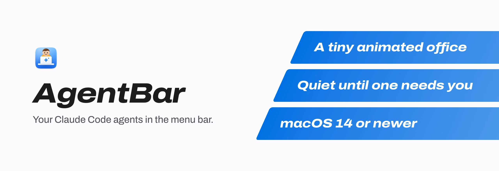
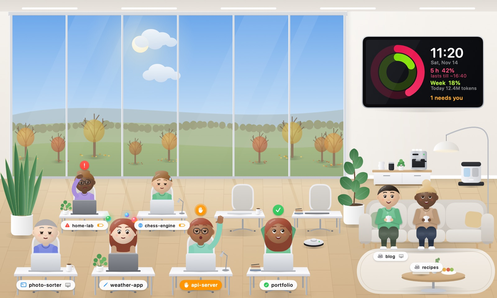
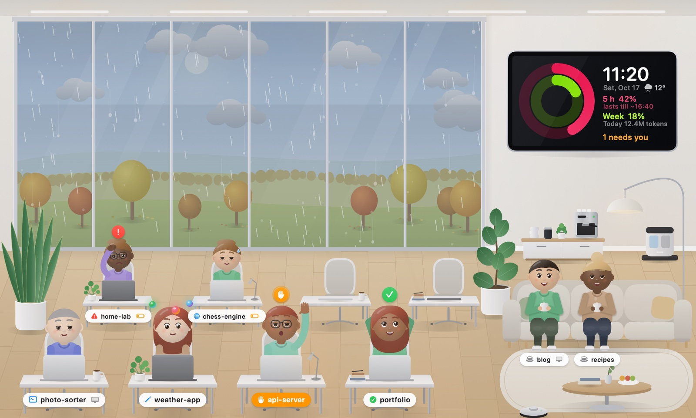
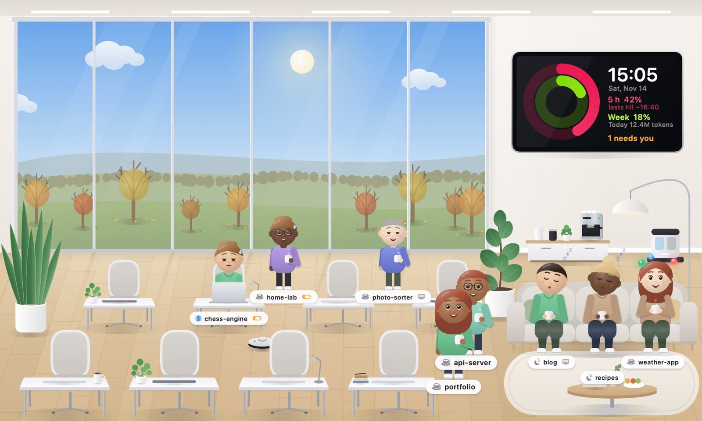
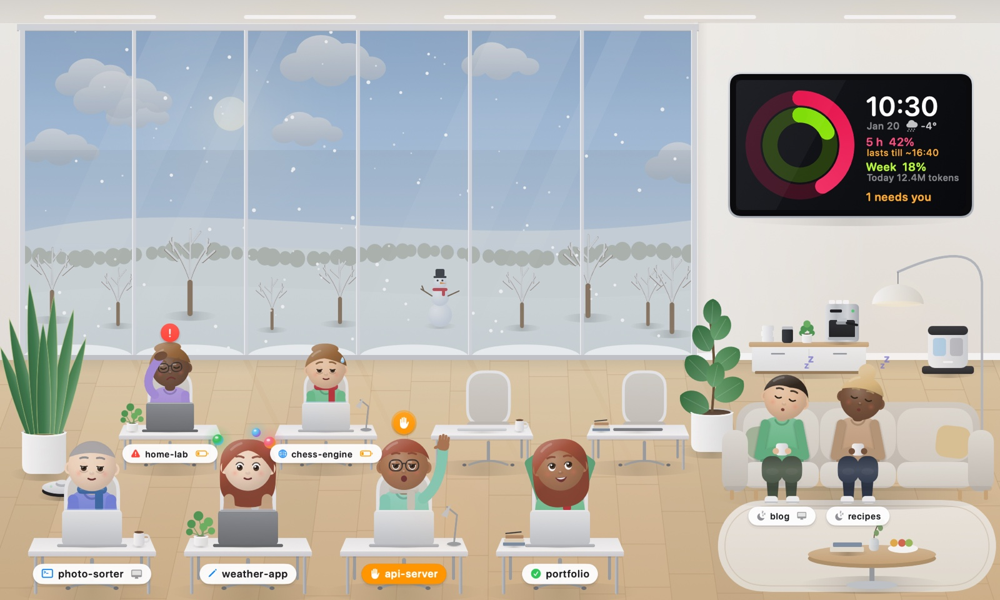
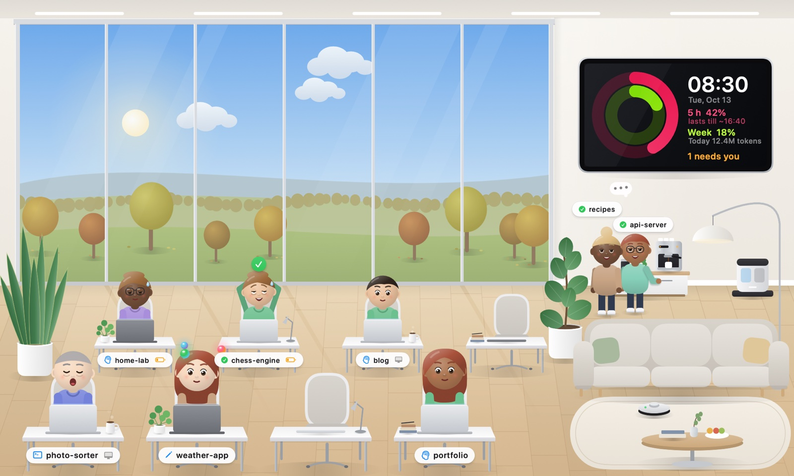

<div align="center">

<picture>
  <source media="(prefers-color-scheme: dark)" srcset="docs/images/readme-title-dark.webp" />
  
</picture>

[](https://github.com/SH1FT-W/agentbar/releases/latest)
[](#set-up)
[](https://github.com/SH1FT-W/agentbar/releases/latest)

<a href="https://sh1ft-w.github.io/agentbar"><b>Website</b></a>&emsp;<a href="#install">Install</a>&emsp;<a href="#set-up">Set up</a>&emsp;<a href="#menu-and-office">Menu and office</a>&emsp;<a href="https://github.com/SH1FT-W/agentbar/releases">Releases</a>&emsp;<a href="README.de.md">Deutsch</a>

</div>

<br/>

AgentBar sits in your Mac's menu bar and shows what every [Claude Code](https://docs.anthropic.com/en/docs/claude-code) session is doing: **working, waiting for you, done or stuck.** It stays quiet until one needs you. Press ⌃⌥A and a tiny office opens where every session works at its own desk.

AgentBar only reads what Claude Code writes on your Mac. It cannot answer prompts or approve anything for you; it brings the right terminal tab to the front so you can.

## What needs what

| | Needs |
|:--|:--|
| Every session with status, project, current activity and context | nothing, AgentBar reads Claude Code's local logs |
| Status the moment it changes (approval, done, error) | Claude Code hooks, set up with one click |
| Tokens, cost and sessions today and over 7 days | nothing |
| Plan usage as rings (5 hours and week) | your Claude Code login from the keychain |
| Notifications | your OK when macOS asks |
| The office with sky and time of day | nothing |
| Real weather behind the office window | a location |
| Sessions from your other Macs | the same pairing code on every Mac |

**New in 26.10:** a coffee bar, seasons, Halloween costumes and rare moments in the office, and a phone symbol for sessions you drive with Remote Control. Every change is in the [releases](https://github.com/SH1FT-W/agentbar/releases).

<a id="install"></a>
## Install

[](https://github.com/SH1FT-W/agentbar/releases/latest)

Unzip `AgentBar.zip` and move `AgentBar.app` to `/Applications`. AgentBar is not notarized by Apple (that needs a paid developer account), so macOS blocks the first launch once: open **System Settings > Privacy & Security**, scroll to *"AgentBar" was blocked* and click **Open Anyway**, or run

```sh
xattr -dr com.apple.quarantine /Applications/AgentBar.app
```

Later updates arrive through the built-in update window and are checked with an Ed25519 signature (key compiled into the app), bundle ID, version and code signature.

<details>
<summary>Build from source</summary>

No Xcode needed, the Command Line Tools are enough (`xcode-select --install`).

```sh
git clone https://github.com/SH1FT-W/agentbar.git
cd agentbar
./build.sh            # build/AgentBar.app
./build.sh install    # copies to /Applications and launches
```

</details>

<a id="set-up"></a>
## Set up

You need macOS 14 or later on Apple Silicon (built and tested on macOS 27) and Claude Code. There is no account and no Dock icon.

1. **Launch it.** Clawd appears in the menu bar: eyes closed when all is idle, eyes open while working, waving when a session needs you. Allow notifications when macOS asks.
2. **Turn on precise detection.** Click **Set Up** on the *Precise detection* card in the menu. AgentBar adds small hook commands to `~/.claude/settings.json` (backup in `settings.json.agentbar-backup`). It applies to Claude sessions started afterwards and can be removed again in Settings.
3. **Allow the keychain.** For the usage rings AgentBar reads Claude Code's login (`Claude Code-credentials`) with the `security` tool. Allow it if macOS asks.
4. **Optional extras.** A location under **Settings > Office** for the real weather, **Launch at login** under **Settings > General**, and **Other Macs** with the same pairing code on every Mac.

The first time you jump to a session, macOS asks whether AgentBar may control your terminal app. AgentBar follows your macOS language, English or German.

<a id="menu-and-office"></a>
## Menu and office

<div align="center">
<picture>
  <source media="(prefers-color-scheme: dark)" srcset="docs/screenshots/en/office-night.jpg" />
  
</picture>
</div>

| Part | Shows |
|:--|:--|
| Session row | Status, project, what it is doing, tokens and a context bar that turns orange when the window is almost full. Sessions from the Terminal, the Claude desktop app, Cowork and Xcode; subagents as helpers. A phone symbol marks Remote Control, a device symbol another Mac. |
| Usage rings | Your 5-hour and weekly plan usage, Apple Watch style, with a forecast of how long the window lasts at your pace. |
| Today and 7 days | Tokens, API-equivalent cost and sessions per day, a 7-day chart and your top projects today. |
| Office (⌃⌥A) | A floating window with a character per session. It types while working, raises a hand when it needs you, goes to the lounge when idle and looks tired as its context fills up. |
| Notifications | When an agent needs you (with its actual question), finishes, fails, runs out of context or seems stuck. Permission prompts after 10 seconds at most, the rest after a delay you choose (20 seconds by default), once per waiting state. Usage warnings at 80 % and 95 %. Quiet hours and a one-hour mute. |
| Keep awake | Stops your Mac from sleeping, always or only while agents work. |

Click a character or press Return on a row and the exact tab comes to the front: Terminal and iTerm2 by tty, Ghostty by folder. In the menu: arrow keys select, Space expands, ⌘R reloads, ⌘, opens Settings. Every row and ring has a VoiceOver label.

<details>
<summary>What happens in the office</summary>
<br/>

The sky follows your local time; with a location you get clouds, rain on the glass, fog, snow on the hills and the real sunrise and sunset. The trees change with the seasons (flipped for the southern hemisphere). The office decorates itself for Valentine's Day, Easter, Halloween, Advent, Christmas and New Year's Eve, and the team dresses for the occasion and the weather. Each character picks its own look for the day and keeps it for the session. Subagents orbit their character as glowing spheres, the robot vacuum speeds up with your CPU load and docks in the evening, and agents that just finished sometimes queue at the espresso machine. Now and then: a shooting star, a flock of birds, a rainbow, a snowman, pizza on Friday lunchtime.

<p align="center">




</p>

</details>

## Your data

- **Local files only.** AgentBar reads Claude Code's session logs (`~/.claude/projects`), the Claude desktop metadata and its own hook log. No analytics, no telemetry.
- **The token is only read.** It goes only to `api.anthropic.com` and is never refreshed, changed or stored elsewhere.
- **Other Macs** get only status, project, title and activity of your sessions, never files or logs, encrypted with the pairing code.

## Good to know

- Without hooks AgentBar infers the state from pauses in the logs, so a waiting approval can show up late.
- Ghostty has no tty in its scripting dictionary. AgentBar switches the tab only when exactly one Ghostty tab is in the session's folder; otherwise it brings Ghostty to the front.
- No notification while the session's terminal is in front, unless *Even when in front* is on.
- Apple Silicon only.

<details>
<summary>How it works</summary>

Without hooks, AgentBar parses the Claude Code JSONL logs (for example, a tool call without a result for a while in a non-auto permission mode probably waits for approval). With hooks, Claude Code reports `PreToolUse`, `PermissionRequest`, `Notification`, `Stop` and so on directly: each hook appends one status line to `~/Library/Application Support/AgentBar/hooks.log`, with no network, no prompts or file contents and no AgentBar process involved. AgentBar also checks whether the Claude process is still alive.

| Talks to | For | When |
|:--|:--|:--|
| `api.anthropic.com` | your plan usage | only while *Fetch usage* is on |
| `api.github.com` | update check | |
| `api.open-meteo.com`, `geocoding-api.open-meteo.com` | weather behind the office window | only once you enter a location, rounded to about 1 km |
| your other Macs | sessions on the other Macs | only if paired; found via Bonjour on the local network |

</details>

<details>
<summary>Development</summary>

```sh
./build.sh snapshot   # renders the office and the dropdown as PNGs into build/
./build.sh test       # self tests
build/AgentBar.app/Contents/MacOS/AgentBar --dump   # lists the detected sessions and exits
AGENTBAR_LANG=en      # or =de, to test a language
```

`build.sh` prefers a macOS 26 SDK from the Command Line Tools (the SDK 27 there lacks the SwiftUI macro plugin); override with `SDK=/path/to/sdk ./build.sh`. Versions are `YY.M.N`: `26.10.11` is the eleventh release of October 2026, and the update check sees it as newer than the old `2.3.1`. Releasing is described in [RELEASING.md](RELEASING.md).

</details>

## License

[MIT](LICENSE). AgentBar was inspired by [so-agentbar](https://github.com/sotthang/so-agentbar) by sotthang and is an independent rewrite with a different design and feature set.

<sub>AgentBar is an independent open-source project, not affiliated with Anthropic or Apple. Claude is a trademark of Anthropic.</sub>
