<div align="center">

<picture>
  <source media="(prefers-color-scheme: dark)" srcset="docs/images/readme-title-dark.webp" />
  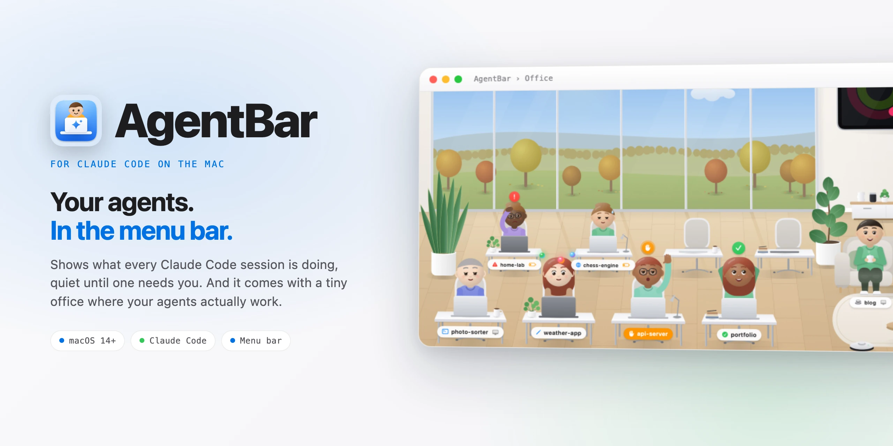
</picture>

<p>AgentBar shows what every <a href="https://docs.anthropic.com/en/docs/claude-code">Claude Code</a> session is doing, quiet until one needs you.<br/>
And it comes with a tiny office where your agents actually work.</p>

<p>🇬🇧 English &nbsp;·&nbsp; <a href="README.de.md">🇩🇪 Deutsch</a></p>

[](https://github.com/SH1FT-W/agentbar/releases/latest)
[](#setup)
[](#setup)
[](LICENSE)

<p><a href="https://sh1ft-w.github.io/agentbar"><b>Website</b></a> &nbsp;·&nbsp; <a href="https://github.com/SH1FT-W/agentbar/releases/latest"><b>Download</b></a> &nbsp;·&nbsp; <a href="#new">New</a> &nbsp;·&nbsp; <a href="#menu">Menu</a> &nbsp;·&nbsp; <a href="#office">Office</a> &nbsp;·&nbsp; <a href="#macs">Other Macs</a> &nbsp;·&nbsp; <a href="#setup">Setup</a> &nbsp;·&nbsp; <a href="#privacy">Privacy</a> &nbsp;·&nbsp; <a href="https://github.com/SH1FT-W/agentbar/releases">Releases</a></p>

</div>

<br/>

<a id="new"></a>
<sub><b>JUST ARRIVED</b></sub>
## A livelier office.

The latest releases gave the team a coffee bar, four seasons outside the window, a few holidays to dress up for and some moments you only catch now and then.

<!-- cards:new -->
<table>
<tr><td width="50%" valign="top"><picture><source media="(prefers-color-scheme: dark)" srcset="docs/images/icons/coffee-outline-dark.svg"></picture> <b>Coffee bar</b> <code>2.3</code><br>Agents that just finished a task sometimes walk over to the espresso machine, queue up, have a little chat and bring the mug back to their desk.</td><td width="50%" valign="top"><picture><source media="(prefers-color-scheme: dark)" srcset="docs/images/icons/leaf-dark.svg"></picture> <b>Seasons</b> <code>2.3</code><br>The trees blossom in spring, turn golden in autumn and go bare in winter. Flipped for the southern hemisphere once a weather location is set.</td></tr>
<tr><td width="50%" valign="top"><picture><source media="(prefers-color-scheme: dark)" srcset="docs/images/icons/halloween-dark.svg"></picture> <b>Halloween</b> <code>2.3</code><br>Pumpkins on the desks, paper bats on the glass, costumes for the team and a ghost sheet over the robot vacuum.</td><td width="50%" valign="top"><picture><source media="(prefers-color-scheme: dark)" srcset="docs/images/icons/cellphone-wireless-dark.svg"></picture> <b>Remote Control</b> <code>26.10.12</code><br>Sessions you drive with Remote Control from your phone or claude.ai carry a small phone symbol next to their name, on your other Macs too.</td></tr>
<tr><td width="50%" valign="top"><picture><source media="(prefers-color-scheme: dark)" srcset="docs/images/icons/star-shooting-outline-dark.svg"></picture> <b>Rare moments</b> <code>2.3</code><br>A shooting star, a flock of birds, a rainbow in light rain, a snowman when snow settles, pizza on Friday lunchtime. Keep an eye on the window.</td><td width="50%" valign="top"><picture><source media="(prefers-color-scheme: dark)" srcset="docs/images/icons/calendar-outline-dark.svg"></picture> <b>Calendar versions</b> <code>26.10.11</code><br>Versions count year.month.number: 26.10.11 is the 11th release of October 2026. The update check sees it as newer than 2.3.1.</td></tr>
</table>
<!-- /cards:new -->

Every change, release by release, in the [releases](https://github.com/SH1FT-W/agentbar/releases).

<br/>

<a id="menu"></a>
<sub><b>THE MENU</b></sub>
## Looks like it came with the Mac.

Built like the system menus in macOS 27. Every session with its status, project and what it is doing right now, your plan usage as activity rings, and a small context bar that turns orange before a session runs out of room.

<div align="center">
<picture>
  <source media="(prefers-color-scheme: dark)" srcset="docs/screenshots/en/menu-live-dark.png" />
  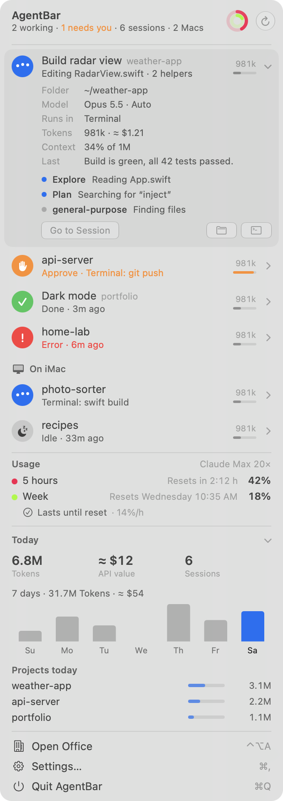
</picture>
</div>

AgentBar sees sessions from the Terminal, the Claude desktop app, Cowork and Xcode. Subagents appear as helpers of their parent session.

<!-- cards:menu -->
<table>
<tr><td width="50%" valign="top"><picture><source media="(prefers-color-scheme: dark)" srcset="docs/images/icons/hand-wave-outline-dark.svg"></picture> <b>Knows when you're needed</b><br>Working, waiting for approval, done, error or idle. With Claude Code hooks AgentBar knows the moment it happens instead of guessing from pauses.</td><td width="50%" valign="top"><picture><source media="(prefers-color-scheme: dark)" srcset="docs/images/icons/chart-donut-dark.svg"></picture> <b>Usage as activity rings</b><br>Your 5-hour and weekly plan usage, Apple Watch style, with a forecast of how long the window lasts at your pace. The token is only read, never refreshed.</td></tr>
<tr><td width="50%" valign="top"><picture><source media="(prefers-color-scheme: dark)" srcset="docs/images/icons/chart-bar-dark.svg"></picture> <b>Today and 7 days</b><br>Tokens, API-equivalent cost and sessions per day, a 7-day chart and your top projects today. Computed locally from Claude Code's logs.</td><td width="50%" valign="top"><picture><source media="(prefers-color-scheme: dark)" srcset="docs/images/icons/gauge-dark.svg"></picture> <b>Context at a glance</b><br>Every row shows tokens and a small context bar. It turns orange when the window is almost full, and the character in the office looks tired too.</td></tr>
<tr><td width="50%" valign="top"><picture><source media="(prefers-color-scheme: dark)" srcset="docs/images/icons/console-dark.svg"></picture> <b>Jump right in</b><br>Click a figure in the office or press Return in the menu, and the exact Terminal tab a session runs in comes to the front.</td><td width="50%" valign="top"><picture><source media="(prefers-color-scheme: dark)" srcset="docs/images/icons/bell-outline-dark.svg"></picture> <b>Notifications</b><br>When an agent needs you (with its actual question), finishes, fails, runs out of context or seems stuck. With quiet hours and a one-hour mute.</td></tr>
<tr><td width="50%" valign="top"><picture><source media="(prefers-color-scheme: dark)" srcset="docs/images/icons/keyboard-outline-dark.svg"></picture> <b>Keyboard and VoiceOver</b><br>Arrow keys to select, Return to jump, Space to expand, ⌘R to reload. Every row and ring has a proper accessibility label.</td><td width="50%" valign="top"><picture><source media="(prefers-color-scheme: dark)" srcset="docs/images/icons/coffee-dark.svg"></picture> <b>Keep awake</b><br>Stop your Mac from sleeping: always, or only while agents are working. Plus launch at login and the update window.</td></tr>
</table>
<!-- /cards:menu -->

<details>
<summary><b>How status detection works</b></summary>
<br/>

Without hooks, AgentBar parses the Claude Code JSONL logs and infers the state (for example, a tool call that is not followed by a result for a while in a non-auto permission mode probably waits for approval). With hooks, Claude Code reports `PreToolUse`, `PermissionRequest`, `Notification`, `Stop` and so on directly, and AgentBar also checks whether the Claude process is still alive.

</details>

<br/>

<a id="office"></a>
<sub><b>THE OFFICE</b></sub>
## Press ⌃⌥A. Every session gets a desk.

A floating window where each session is a Memoji-like character. They type while working, raise a hand when they need you, head to the lounge when idle and look more tired as their context fills up. Fresh again after `/compact`.

<p align="center">
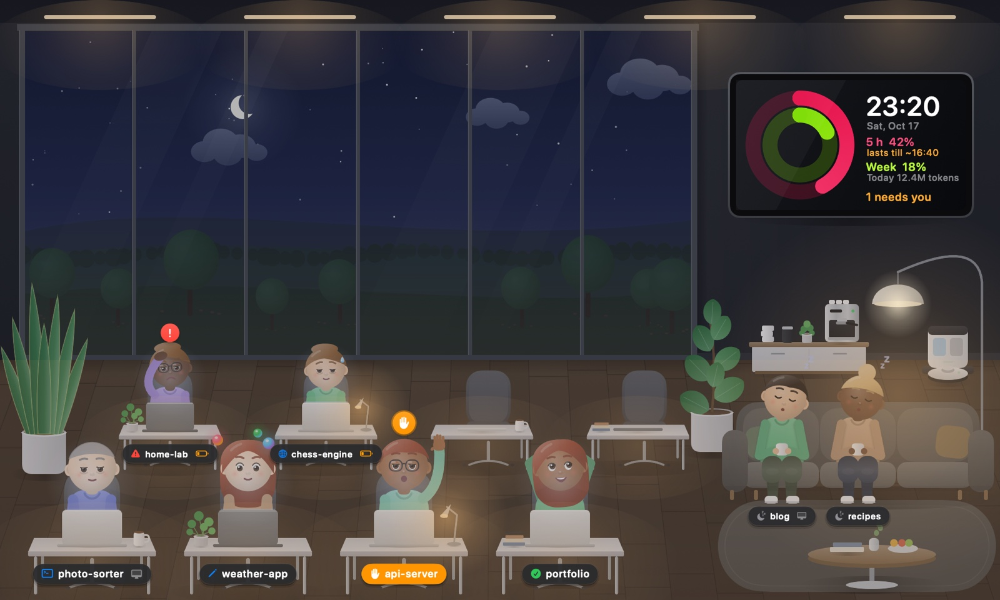
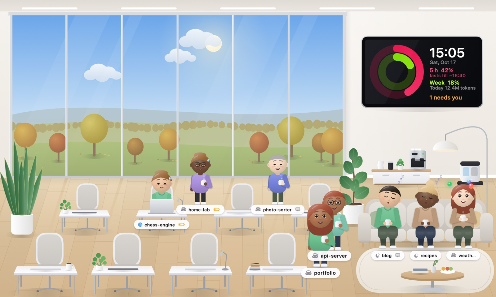
<br/><sub>Late night, warm lights: the robot vacuum heads to its dock when the lamps come on. The lounge fills up with everyone who has nothing to do right now.</sub>
</p>

<!-- cards:office -->
<table>
<tr><td width="50%" valign="top"><picture><source media="(prefers-color-scheme: dark)" srcset="docs/images/icons/weather-partly-cloudy-dark.svg"></picture> <b>Sky, weather, daylight</b><br>The sky follows your local time. With a location you get clouds, rain on the glass, fog, snow on the hills, the real sunrise and sunset. Only the location rounded to about 1 km is sent.</td><td width="50%" valign="top"><picture><source media="(prefers-color-scheme: dark)" srcset="docs/images/icons/party-popper-dark.svg"></picture> <b>Holidays and outfits</b><br>The office decorates itself for Valentine's Day, Easter, Halloween, Advent, Christmas and New Year's Eve, and the team dresses for the occasion and the weather.</td></tr>
<tr><td width="50%" valign="top"><picture><source media="(prefers-color-scheme: dark)" srcset="docs/images/icons/orbit-dark.svg"></picture> <b>Helpers orbit</b><br>Subagents show up as glowing spheres around their character. The robot vacuum speeds up with your CPU load and docks in the evening.</td><td width="50%" valign="top"><picture><source media="(prefers-color-scheme: dark)" srcset="docs/images/icons/account-outline-dark.svg"></picture> <b>One look per session</b><br>Every character picks its own look each day and keeps it for the whole session. Click one and its Terminal tab comes to the front.</td></tr>
</table>
<!-- /cards:office -->

<p align="center">
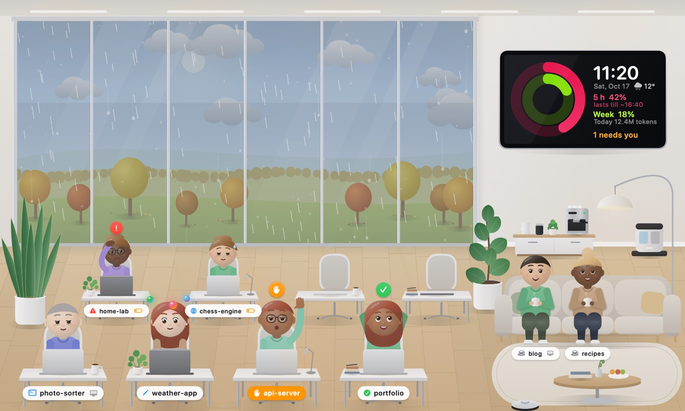
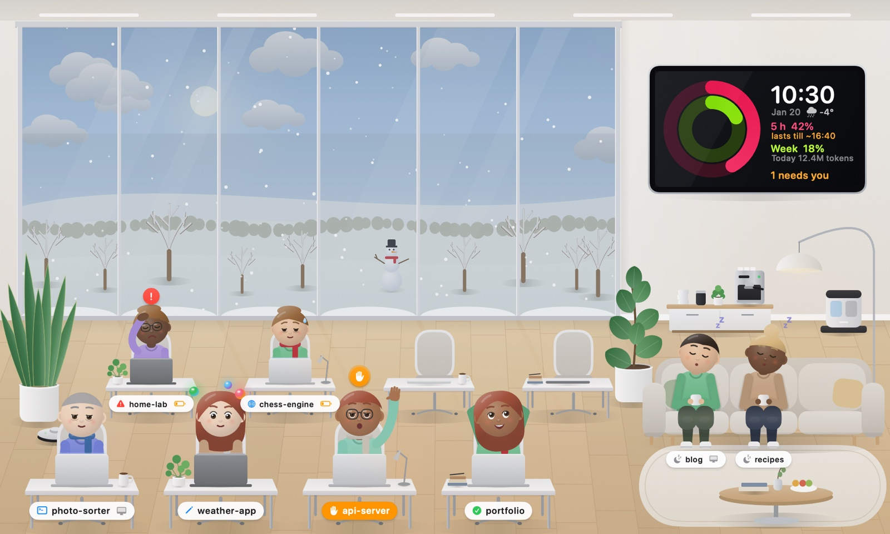
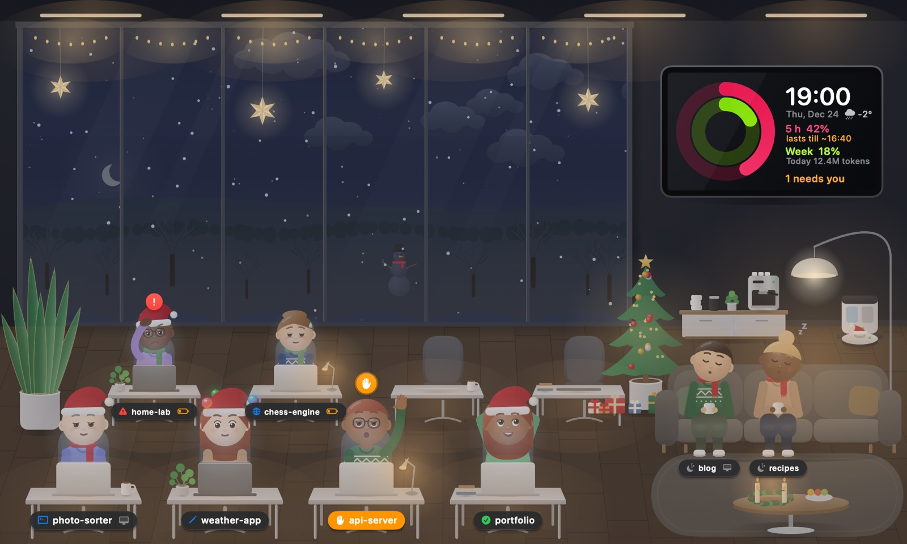
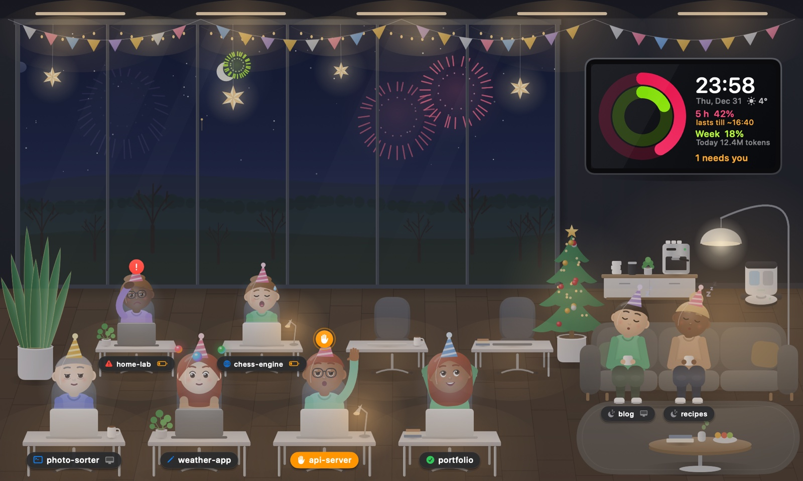
<br/><sub>Real weather from your location. Snow that settles, scarves when it's freezing. It decorates itself through Advent. Party hats and fireworks on New Year's Eve.</sub>
</p>

<details>
<summary><b>More screenshots</b></summary>
<br/>

<p align="center">
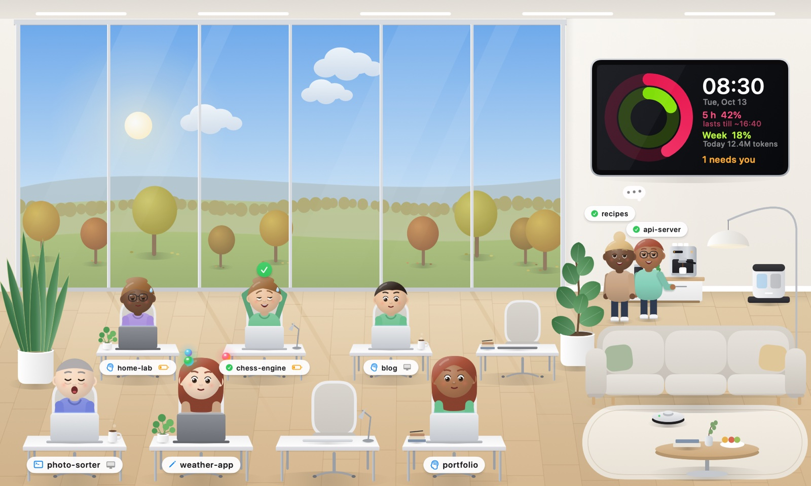
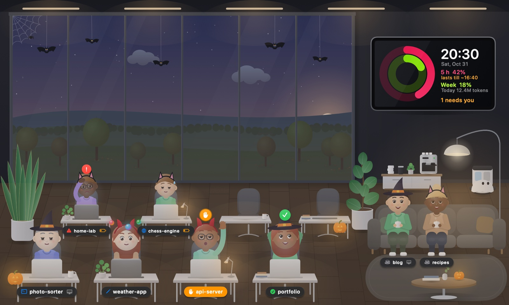
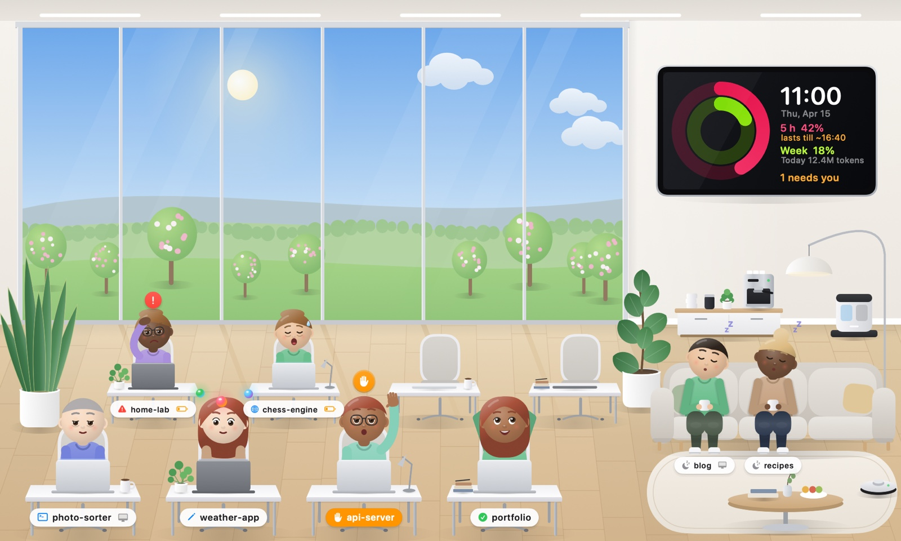
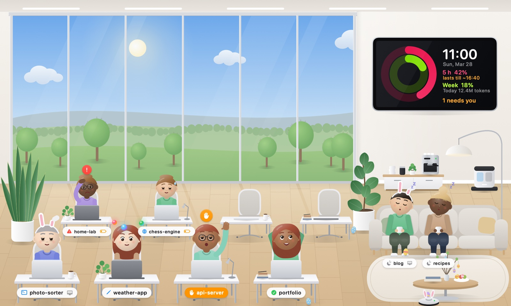
<br/><sub>Coffee bar, Halloween, spring and Easter.</sub>
</p>

</details>

<br/>

<a id="macs"></a>
<sub><b>OTHER MACS</b></sub>
## One office for all your Macs.

Pair your Macs with a code and the sessions running on the others show up in the menu and in the office, marked with a small device symbol. Discovery via Bonjour on your local network, every message encrypted with the pairing code.

1. **Turn on Other Macs** in Settings and enter the same pairing code on every Mac.
2. **Wait a moment.** A Mac only answers after the other side has proved it knows the code.
3. **That's it.** Only status, project, title and activity of sessions are shared, never files or logs.

<details>
<summary><b>The settings</b></summary>
<br/>

<div align="center">
<picture>
  <source media="(prefers-color-scheme: dark)" srcset="docs/screenshots/en/settings-dark.png" />
  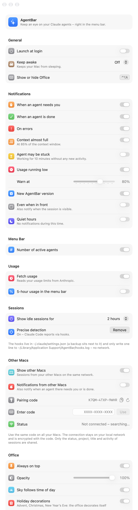
</picture>
</div>

</details>

<br/>

<a id="setup"></a>
<sub><b>SETUP</b></sub>
## Set up in a minute.

No account, no installer. Just the app. Everything beyond the two requirements is optional and off until you turn it on.

**Required:** macOS 14 or later on Apple Silicon (built and tested on macOS 27), and [Claude Code](https://docs.anthropic.com/en/docs/claude-code), whose local session logs AgentBar reads. **Optional:** Claude Code hooks for precise detection, a weather location for the real weather in the office, and other Macs paired with a code.

### Install

1. Download `AgentBar.zip` from the [latest release](https://github.com/SH1FT-W/agentbar/releases/latest) and unzip it.
2. Move `AgentBar.app` to `/Applications`.
3. **Allow the first launch.** AgentBar is open source but not notarized by Apple (that requires a paid developer account), so macOS blocks the first launch with *"AgentBar" can't be opened*. Allow it once, either way:
   - Open **System Settings → Privacy & Security**, scroll down to *"AgentBar" was blocked* and click **Open Anyway**, then confirm; **or**
   - in Terminal:
     ```sh
     xattr -dr com.apple.quarantine /Applications/AgentBar.app
     ```
   Only the first launch needs this step. Later updates arrive through the built-in update window and are verified with an Ed25519 signature (key compiled into the app), bundle ID, version and code signature.
4. Launch it. A small Clawd icon appears in the menu bar (eyes closed: idle, eyes open: working, waving: a session needs you). There is no Dock icon.

### First run

- **Notifications:** macOS asks once whether AgentBar may send notifications.
- **Precise detection:** click **Set up** on the *Precise detection* card in the dropdown (or *Settings → Precise detection*). AgentBar adds small hook commands to `~/.claude/settings.json` (a backup is written to `settings.json.agentbar-backup`). Each hook appends one status line to `~/Library/Application Support/AgentBar/hooks.log`: no network, no prompts or file contents, no AgentBar process involved. Applies to Claude sessions started afterwards. You can remove the hooks again at any time from the settings.
- **Usage rings:** AgentBar reads Claude Code's login from the keychain (`Claude Code-credentials`) via the `security` tool. If macOS asks, allow it. The token is sent only to `api.anthropic.com`.
- **Weather:** enter a location under *Settings → Office* if you want the real weather behind the glass. Without a location the office only follows the time of day.
- **Jump to Terminal:** the first time you jump to a session, macOS asks whether AgentBar may control Terminal. This is used only to select the right tab.
- **Launch at login:** toggle *Launch at login* in *Settings → General*.
- **Language:** AgentBar follows your macOS language, German or English.

### Shortcuts

| Shortcut | Action |
|:--|:--|
| ⌃⌥A | Show or hide the office (system-wide) |
| ⌘, | Settings (while the dropdown is open) |
| ⌘R | Reload the session list |

### Build from source

No Xcode needed, the Command Line Tools are enough (`xcode-select --install`).

```sh
git clone https://github.com/SH1FT-W/agentbar.git
cd agentbar
./build.sh            # build/AgentBar.app
./build.sh install    # copies to /Applications and launches
./build.sh snapshot   # renders the office + dropdown as PNGs into build/
```

`build.sh` prefers a macOS 26 SDK from the Command Line Tools (the SDK 27 in the Command Line Tools lacks the SwiftUI macro plugin); override with `SDK=/path/to/sdk ./build.sh`.

Diagnostics: `build/AgentBar.app/Contents/MacOS/AgentBar --dump` lists the detected sessions and exits. Test a language with `AGENTBAR_LANG=en` or `=de`.

### Versions

AgentBar uses calendar versions **`YY.M.N`**: two-digit year, month without a leading zero, and the number of the release within that month. `26.10.11` is the eleventh release of October 2026; the next month starts again at `.1` (for example `26.11.1`). Every release, feature or fix, gets the next number. Tags and release titles carry a `v` prefix (`v26.10.11`). The jump from the old `2.3.1` scheme to `26.10.11` is intended: the update check treats it as newer, so *Check for Updates* finds it as usual.

<br/>

<a id="privacy"></a>
<sub><b>PRIVACY</b></sub>
## It stays on your Mac.

- **Local files only.** AgentBar reads Claude Code's session logs (`~/.claude/projects`), the Claude desktop metadata and its own hook log. No analytics, no telemetry.
- **The token is only read.** For the usage rings AgentBar reads Claude Code's login from the keychain and sends it only to Anthropic. It is never refreshed, modified or stored elsewhere.
- **Open source.** The whole app is on [GitHub](https://github.com/SH1FT-W/agentbar) under the MIT license, and you can build it yourself with the Command Line Tools.

The only servers it talks to:

| | |
|:--|:--|
| `api.anthropic.com` | your plan usage, only while *Fetch usage* is on |
| `api.github.com` | checking for updates |
| `api.open-meteo.com`, `geocoding-api.open-meteo.com` | weather behind the office window, only once you enter a location; the location is rounded to about 1 km |
| Your other Macs | only if you pair them, on the local network, encrypted with the pairing code; only status, project, title and activity of sessions are shared, never files or logs |

<br/>

<sub><b>CREDITS</b></sub>
## Inspired by so-agentbar

AgentBar was inspired by [so-agentbar](https://github.com/sotthang/so-agentbar) by sotthang. It is an independent rewrite with a different design and feature set.

AgentBar is an independent open-source project, not affiliated with Anthropic or Apple. Claude is a trademark of Anthropic. Licensed under [MIT](LICENSE).

<br/>

<div align="center">
  <sub>A <a href="https://sh1ft-w.github.io"><b>SH1FT-W</b></a> project &nbsp;·&nbsp; <a href="https://sh1ft-w.github.io/casora">Casora</a> &nbsp;·&nbsp; <a href="https://sh1ft-w.github.io/flode">FLODE</a> &nbsp;·&nbsp; <a href="https://sh1ft-w.github.io/pulse">Pulse</a> &nbsp;·&nbsp; <a href="https://sh1ft-w.github.io/evenlight">Evenlight</a> &nbsp;·&nbsp; <a href="https://sh1ft-w.github.io/sharemount">ShareMount</a> &nbsp;·&nbsp; Built with <a href="https://claude.ai">Claude</a></sub>
</div>
