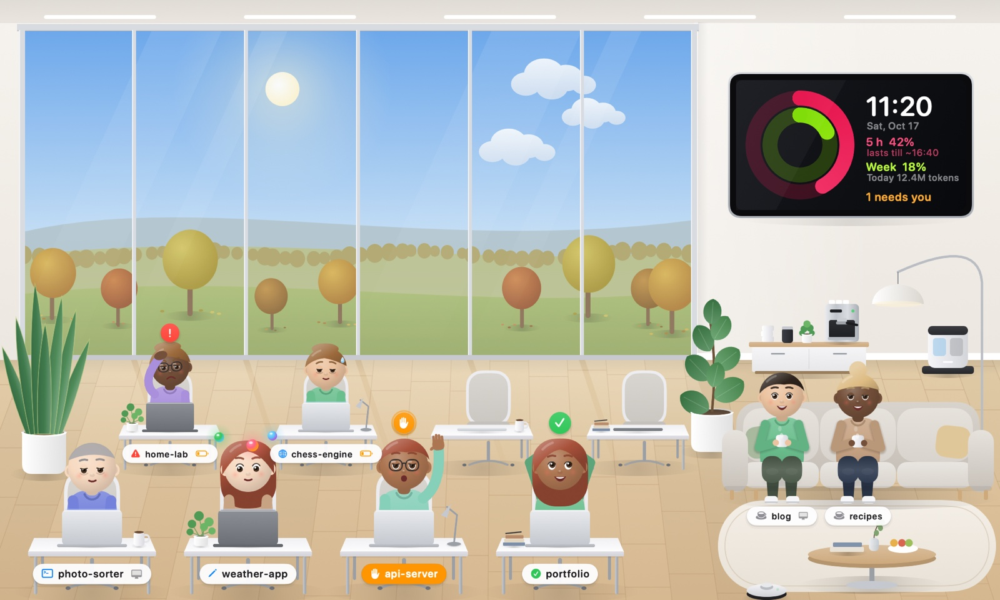
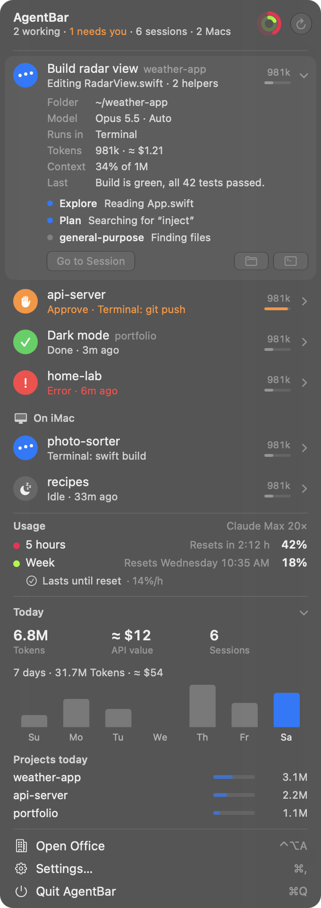

<p align="center">
  
</p>

<h1 align="center">AgentBar</h1>

<p align="center">
  A macOS menu bar app that shows what your <a href="https://docs.anthropic.com/en/docs/claude-code">Claude Code</a> agents are doing,<br>
  styled like a native macOS 27 system menu, with a little animated office where every session sits at its own desk.
</p>

<p align="center">
  🇬🇧 English · <a href="README.de.md">🇩🇪 Deutsch</a>
</p>

<p align="center">
  <a href="https://github.com/SH1FT-W/agentbar/releases/latest"></a>
  
  
  <a href="LICENSE"></a>
</p>

<p align="center">
  <a href="https://github.com/SH1FT-W/agentbar/releases/latest">Download</a> ·
  <a href="https://sh1ft-w.github.io/agentbar/">Website</a> ·
  <a href="#setup">Setup</a> ·
  <a href="#versions">Versions</a>
</p>

<p align="center">
  
</p>

<p align="center">
  
  &nbsp;
  
</p>

> **Language:** AgentBar follows your macOS language, German or English.

## Features

- **Live session status:** working, needs you, done, error or idle, for every Claude Code session (terminal, Claude desktop app, Cowork, Xcode). Subagents appear as helpers of their parent session.
- **Precise detection (optional):** with Claude Code hooks AgentBar knows *exactly* when an agent is waiting for your approval instead of guessing from pauses.
- **Usage rings:** your 5-hour and weekly Claude plan usage as Apple-Watch-style activity rings, plus a forecast of how long your 5-hour window will last at the current pace. The OAuth token is only *read*, never refreshed or modified.
- **Today and last 7 days:** tokens, API-equivalent cost and sessions per day, a 7-day bar chart and your top projects today. Computed locally from Claude Code's session logs.
- **Context at a glance:** every row shows tokens and a small context bar that turns orange when the context window is almost full.
- **The office:** a floating window (⌃⌥A) where each session is a Memoji-like character. It types while working, raises a hand when it needs you, walks over to the lounge when idle, and looks more and more tired as its context window fills up (fresh again after /compact).
- **Coffee bar:** agents that just finished a task sometimes fetch a coffee from the espresso machine behind the sofa, queue up, have a little chat and bring the mug back to their desk.
- **Weather and time of day:** the sky follows your local time and, if you enter a location, the real weather: clouds, rain running down the glass, fog, thunderstorms, snow that settles on the hills, real sunrise and sunset, lamps that come on in gloomy weather. Weather comes from Open-Meteo.
- **Seasons:** the trees outside blossom in spring, turn golden in autumn and go bare in winter (flipped for the southern hemisphere when a weather location is set).
- **Holidays:** the office decorates itself for Valentine's Day, Easter (egg tree, hidden eggs, bunny ears), Halloween (pumpkins, paper bats, costumes, a ghost robot vacuum), Advent, St. Nicholas, Christmas and New Year's Eve, and the team dresses up for the occasion and the weather: Santa hats, antlers, party hats, scarves when it's freezing, sunglasses when it's hot.
- **Rare moments:** every now and then there's a shooting star, a flock of birds, a rainbow in light rain, a snowman when snow settles, or pizza on Friday lunchtime.
- **Helpers and the robot vacuum:** subagents orbit their character as glowing spheres; a robot vacuum speeds up with your CPU load and heads back to its charging dock when the lights go on in the evening.
- **Jump to the session:** click a figure in the office, or use "Go to Session" (or Return) in the menu, to bring its Terminal tab to the front.
- **Notifications** when an agent needs you (with the actual question it asks), finishes or fails, when its context is almost full or it seems stuck, plus a usage warning and a heads-up when a new AgentBar version is out. Actions to jump to the session or mute it for an hour, and optional quiet hours.
- **Keyboard and VoiceOver:** ↑/↓ to select, Return to jump to the session, Space to expand, ⌘R to reload; every row and ring has a proper accessibility label.
- **Your other Macs (optional):** pair your Macs with a code and sessions running on the others show up in the menu and in the office, marked with a small device symbol. Discovery via Bonjour on your local network, every message encrypted with the pairing code.
- **Keep awake:** off, always, or only while agents are working.
- **Updates** via GitHub Releases: a small window at launch offers Install Now, Later or Skip (it never steals keyboard focus). Every update is verified with an Ed25519 signature (key compiled into the app), bundle ID, version and code signature.

<p align="center">
  
</p>

<p align="center">
  
  
</p>
<p align="center">
  
  
</p>
<p align="center">
  
  
</p>
<p align="center">
  
  
</p>

## Setup

### Requirements

- macOS 14 or later on Apple Silicon (built and tested on macOS 27)
- [Claude Code](https://docs.anthropic.com/en/docs/claude-code): AgentBar reads its local session logs

### Install

1. Download `AgentBar.zip` from the [latest release](https://github.com/SH1FT-W/agentbar/releases/latest) and unzip it.
2. Move `AgentBar.app` to `/Applications`.
3. **Gatekeeper:** AgentBar is open source but not notarized by Apple (that requires a paid developer account), so macOS blocks the first launch with *"AgentBar" can't be opened / Apple could not verify…*. Allow it once, either way:
   - Open **System Settings → Privacy & Security**, scroll down to *"AgentBar" was blocked…* and click **Open Anyway**, then confirm; **or**
   - in Terminal:
     ```sh
     xattr -dr com.apple.quarantine /Applications/AgentBar.app
     ```
   You only need to do this once. Later updates via the built-in update window install without this prompt; they are verified with an Ed25519 signature instead.
4. Launch it. A small Clawd icon appears in the menu bar (eyes closed: idle, eyes open: working, waving: a session needs you). There is no Dock icon.

### First run

- **Notifications:** macOS asks once whether AgentBar may send notifications.
- **Precise detection:** click **Set up** on the *Precise detection* card in the dropdown (or *Settings → Precise detection*). AgentBar adds small hook commands to `~/.claude/settings.json` (a backup is written to `settings.json.agentbar-backup`). Each hook appends one line to `~/Library/Application Support/AgentBar/hooks.log`: no network, no AgentBar process involved. Applies to Claude sessions started afterwards. You can remove the hooks again at any time from the settings.
- **Usage rings:** AgentBar reads Claude Code's login from the keychain (`Claude Code-credentials`) via the `security` tool. If macOS asks, allow it. The token is sent only to `api.anthropic.com`.
- **Weather:** enter a location under *Settings → Office* if you want the real weather behind the glass. Without a location the office only follows the time of day.
- **Jump to Terminal:** the first time you jump to a session, macOS asks whether AgentBar may control Terminal. This is used only to select the right tab.
- **Launch at login:** toggle *Launch at login* in *Settings → General*.

### Shortcuts

| Shortcut | Action |
|---|---|
| ⌃⌥A | Show / hide the office (global) |
| ⌘, | Settings (while the dropdown is open) |

## Versions

AgentBar uses calendar versions in the form **YY.M.N**: two-digit year, month without a leading zero, and the running number of the release within that month. **26.10.11** is the eleventh release of October 2026; the next month starts again at `.1` (for example `26.11.1`). Tags and release titles carry a `v` prefix (`v26.10.11`). The jump from the old `2.3.1` scheme to `26.10.11` is intended: the update check treats it as newer, so *Check for Updates* finds it as usual.

## Build from source

No Xcode needed, the Command Line Tools are enough (`xcode-select --install`).

```sh
git clone https://github.com/SH1FT-W/agentbar.git
cd agentbar
./build.sh            # → build/AgentBar.app
./build.sh install    # → copies to /Applications and launches
./build.sh snapshot   # → renders the office + dropdown as PNGs into build/
```

`build.sh` prefers a macOS 26 SDK from the Command Line Tools (the SDK 27 in the Command Line Tools lacks the SwiftUI macro plugin); override with `SDK=/path/to/sdk ./build.sh`.

Diagnostics: `build/AgentBar.app/Contents/MacOS/AgentBar --dump` lists the detected sessions and exits. Test a language with `AGENTBAR_LANG=en` or `=de`.

## Privacy

Everything stays on your Mac. AgentBar only reads local files (`~/.claude/projects`, Claude desktop metadata, its own hook log) and talks to these servers:

- `api.anthropic.com`: your plan usage (only if *Fetch usage* is on)
- `api.github.com`: checking for updates
- `api.open-meteo.com` and `geocoding-api.open-meteo.com`: weather behind the office window (only once you enter a location; only the location, rounded to about 1 km, is sent)

If you turn on *Other Macs*, AgentBar also talks to your paired Macs on the local network (Bonjour, encrypted with the pairing code). Only the status, project, title and activity of sessions are shared, never files or logs.

No analytics, no telemetry.

## How status detection works

Without hooks, AgentBar parses the Claude Code JSONL logs and infers the state (e.g. a tool call that isn't followed by a result for a while in a non-auto permission mode probably waits for approval). With hooks, Claude Code reports `PreToolUse`, `PermissionRequest`, `Notification`, `Stop` etc. directly, and AgentBar also checks whether the Claude process is still alive.

## Credits

Inspired by [so-agentbar](https://github.com/sotthang/so-agentbar) by sotthang. AgentBar is an independent rewrite with a different design and feature set.

## License

[MIT](LICENSE). AgentBar is an independent project, not affiliated with Anthropic or Apple. Claude is a trademark of Anthropic.
